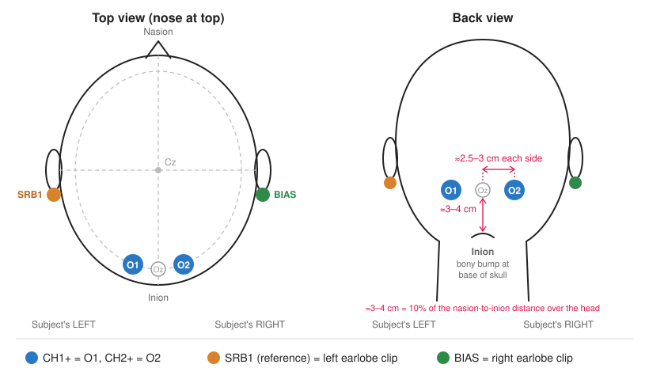

# Eyes-Open / Eyes-Closed Alpha Test

A browser-based tool that records an alternating eyes-open (EO) / eyes-closed (EC) protocol from an ESP-EEG over USB and measures the occipital alpha (8–13 Hz) change.

## Run it

```bash
pip install numpy pyserial          # matplotlib is optional (PNG figures)
cd Characterization/alpha_test
python3 alpha_test.py
```

The GUI opens in your browser. Pick the board's serial port, click **Connect** (the board takes ~5 s to boot), check the live signal, then click **Start recording**. Works with V1, V2 and 16CH boards.

## Electrode setup (2 channels)



| Pin | Site |
|---|---|
| CH1+ | O1 (best contact of all, BIAS works through CH1) |
| CH2+ | O2 |
| SRB1 | earclip, one ear |
| BIAS | earclip, other ear |

O1/O2: find the inion (bump at the back of the skull), go ~10% of the nasion–inion distance up (≈3–4 cm) for Oz, then ~2.5–3 cm left (O1) and right (O2). Short unused channel inputs to SRB1.

## Protocol

Defaults: 5 s lead-in (not recorded), then 3 cycles of 20 s EO + 20 s EC (2 min). The first 3 s after each switch is excluded from analysis. Cues are given on screen, as tones (one low tone = close eyes, two high tones = open eyes) and as speech, so the subject can follow with eyes closed. Use **Full-screen cue** to show the cue and fixation dot to the subject.

Block boundaries are counted in samples, not wall-clock time, so the condition labels in the saved file line up exactly with the data.

## Output

Each run is saved to `recordings/<date_time>/`:

| File | Contents |
|---|---|
| `raw.csv` | Every channel, **unfiltered**, in µV, with sample index, block, condition and whether each sample is used in the analysis |
| `meta.json` | Board, channels, protocol, subject ID, setup notes |
| `results.json` | The analysis below |
| `psd_eo_vs_ec.png`, `spectrogram.png` | Figures (if matplotlib is installed) |
| `results_page.png` | Screenshot of the GUI's Results page, saved automatically when a run finishes (or with **Save screenshot**) |

Re-run the analysis on any saved recording with:

```bash
python3 alpha_test.py --analyze recordings/<date_time>
```

## Analysis

- Welch PSD per condition: 4 s Hann segments, 50% overlap, linear detrend, no filters. Segments never cross a block boundary.
- Alpha power: PSD integrated over 8–13 Hz (µV²), also given as µVrms.
- Reported per channel: EO and EC alpha, EC/EO power ratio, EC peak alpha frequency, how many EC blocks exceed every EO block, and 1–40 Hz RMS.
- Spectrogram: 2 s windows, 0.5 s step.

Alpha amplitude varies a lot between people and sessions. The result shows the full system records a known physiological signal; it is not a spec to compare between devices.

<sub><b>V1 boards:</b> before running this test, reflash with only CH1P as a BIAS input (register 0x0D BIAS_SENSP = <code>0b00000001</code>, 0x0E BIAS_SENSN = <code>0</code>). The stock V1 firmware feeds all 8 channels into BIAS, and unconnected, floating channels confuse the bias pin. V2 and 16CH firmware already use CH1 only.</sub>
