# ESP-EEG Characterization (V2 and 16CH Device Characterization)

(The 1.19 µVrms input test, noise floor test and CMRR test were run on both the ESP-EEG V2 and the 16-channel ESP-EEG.)

**Real bench data, no shielding.**

<table>
  <tr>
    <th align="left">Measurement</th>
    <th align="center">ESP-EEG V2</th>
    <th align="center">16CH ESP-EEG</th>
  </tr>
  <tr>
    <td><b>1.19 µVrms input</b> Measured value (accuracy)</td>
    <td align="center"><b>1.17 µVrms</b> (98%)</td>
    <td align="center"><b>1.15 µVrms</b> (97%)</td>
  </tr>
  <tr>
    <td><b>Noise floor</b> Inputs shorted, with BIAS</td>
    <td align="center"><b>≤ 0.14 µVrms</b></td>
    <td align="center"><b>≤ 0.13 µVrms</b></td>
  </tr>
  <tr>
    <td><b>CMRR</b> Channel 1, 50 Hz</td>
    <td align="center"><b>135 dB</b></td>
    <td align="center"><b>140 dB</b></td>
  </tr>
</table>

- CMRR **at least 25 dB above** the ADS1299's 110 dB minimum spec
- **18× better** rejection than the best other open-source board we found

[cerelog.com](https://cerelog.com)

---

1. [1.19 µVrms Input Test](#1-119-µvrms-input-test)
2. [Noise Floor](#2-noise-floor)
3. [Common-Mode Rejection Ratio (CMRR)](#3-common-mode-rejection-ratio-cmrr)

---

## 1. 1.19 µVrms Input Test

The ESP-EEG V2 and 16-channel ESP-EEG were **physically tested on the bench with a 1.19 µVrms, 20 Hz input signal, proving they can resolve microvolt-level signals.** The V2 measured **1.17 µVrms** and the 16CH measured **1.15 µVrms**, within 2% and 3.4% of the expected value, each with a clean 20 Hz peak in the spectrum. Typical scalp EEG signals are roughly 10–100 µV, so this is well below the level of the signals the device is built to record.

### Test setup

The test circuit is adapted from the test setup in the Texas Instruments ADS1299 datasheet. It uses the same circuit topology TI uses to characterize the chip, with component values adjusted for the function generator and parts used here.

Function generators can't output microvolt-level signals cleanly; at that level their own noise is bigger than the signal. So the generator (Digilent Analog Discovery 2) was set to 250 µV amplitude and reduced with a precision resistive divider (÷148), followed by an RC low-pass filter that removes high-frequency noise and RF pickup from the generator. The signal was fed into channel 1, referenced to SRB1. Bias was not connected, since this is a direct input test.

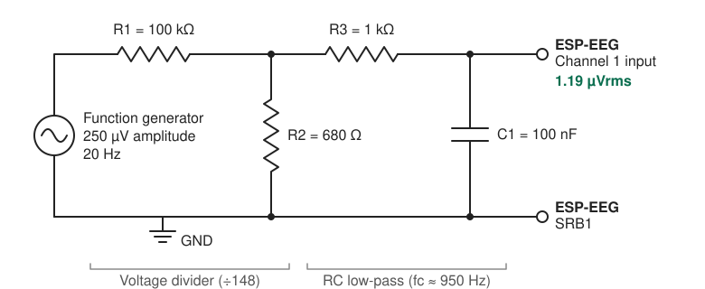

<table>
  <tr>
    <th align="center">ESP-EEG V2 setup</th>
    <th align="center">16CH ESP-EEG setup</th>
  </tr>
  <tr>
    <td align="center"><a href="setup.jpg">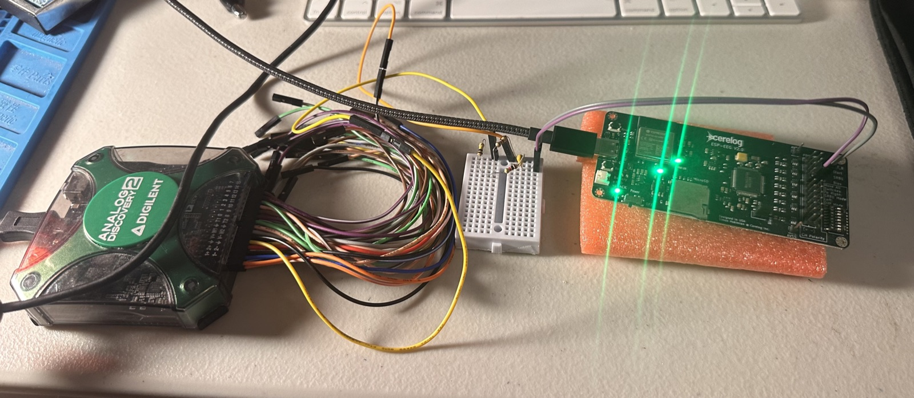</a></td>
    <td align="center"><a href="16ch_test_insetup.jpg">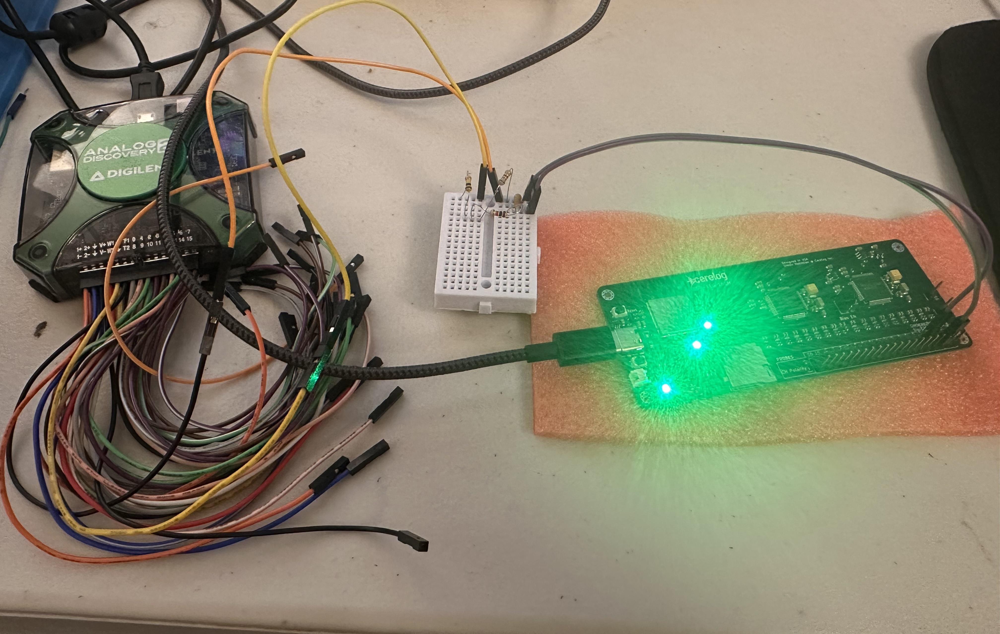</a></td>
  </tr>
</table>

**Bench setup (both boards):** Digilent Analog Discovery 2 (left), voltage divider and RC filter on a breadboard (center), ESP-EEG under test (right). Open bench, no shielded enclosure.

### Signal at the input

**Voltage divider**

$$
\frac{V_{out}}{V_{in}} = \frac{R_2}{R_1 + R_2} = \frac{680}{100\,000 + 680} = \frac{1}{148}
$$

$$
\frac{250\ \mu V}{148} = 1.69\ \mu V \text{ amplitude}
$$

**Amplitude to RMS**

$$
1.69\ \mu V \times 0.707 = \mathbf{1.19\ \mu V_{RMS}}
$$

**RC filter**

$$
f_c = \frac{1}{2\pi \,(675 + 1000)\,\Omega \times 100\ \text{nF}} \approx 950\ \text{Hz}
$$

The filter sees the divider's 675 Ω source resistance in series with R3. At 20 Hz it has no meaningful effect on the amplitude, so the signal at the input is **1.19 µVrms**.

| Stage | Signal |
|-------|--------|
| Function generator | 250 µV amplitude |
| After divider (÷148) | 1.69 µV amplitude |
| **At ESP-EEG input** | **1.19 µVrms** |

### Result

<table>
  <tr>
    <th align="center">ESP-EEG V2</th>
    <th align="center">16CH ESP-EEG</th>
  </tr>
  <tr>
    <td align="center"><a href="v2_250uVin.jpg">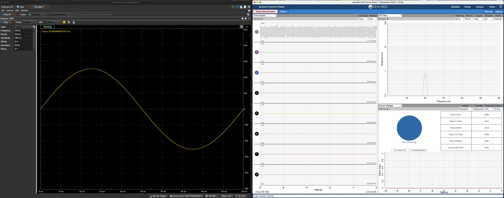</a></td>
    <td align="center"><a href="16ch_250u_Vin.png">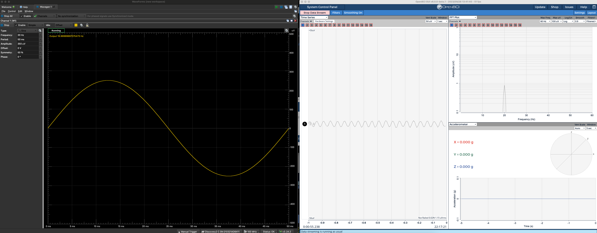</a></td>
  </tr>
  <tr>
    <td>Channel 1 reads <b>1.17 µVrms</b>. Channels 2–8 were turned off for a clean display. A 50/60 Hz notch filter was on in the GUI; the measured value is the same with it off.</td>
    <td>Channel 1 reads <b>1.15 µVrms</b>. Channels 2–16 were turned off for a clean display.</td>
  </tr>
</table>

In each screenshot, **left:** function generator output, a 20 Hz sine at 250 µV amplitude, before the ÷148 divider. **Right:** ESP-EEG recording, with a single clear peak at 20 Hz in the FFT. Click an image to enlarge.

| | Expected | V2 measured | 16CH measured |
|---|----------|-------------|---------------|
| Signal at ESP-EEG input | 1.19 µVrms | **1.17 µVrms** | **1.15 µVrms** |
| Frequency | 20 Hz | 20 Hz | 20 Hz |
| Difference | | 1.7% (within resistor tolerance) | 3.4% (within resistor tolerance) |

---

## 2. Noise Floor

**What it measures:** The smallest signal level the ESP-EEG can distinguish, set by its own internal noise with no signal applied. Lower is better.

### Test setup

Every channel input, SRB1 and the BIAS pin are shorted together. BIAS holds the shorted inputs at the amplifier's reference voltage, as the bias electrode does on the head. No signal is applied.

**An easy way to do this:** every CHx− pin is connected to SRB1 on the PCB, so a jumper across each channel's CHx+ and CHx− pins shorts that channel's input to SRB1. A Y-splitter then connects BIAS to CH1, tying BIAS to the shorted inputs. The setup is identical on the V2 (8 channels) and the 16CH (16 channels).

<a href="16ch_noise_floor.jpg">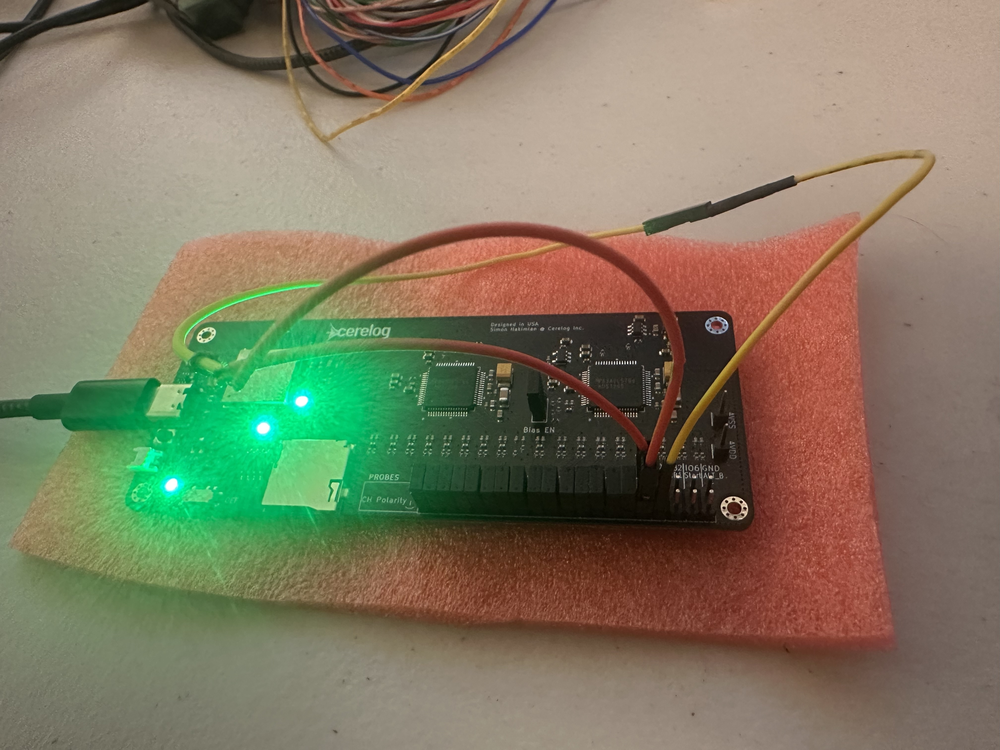</a>

**Noise floor setup (16CH shown, V2 identical with 8 channels):** a jumper on each channel's CHx+/CHx− pins, and a Y-splitter connecting BIAS to CH1. Open bench, no shielded enclosure.

For an accurate result, **terminate every channel, not just the one under test.** A floating input can drift to several volts, and a signal that large can couple into neighboring channels and raise their apparent noise floor. This applies to any high-impedance multichannel EEG amplifier, so connect all inputs before measuring.

### Procedure

1. **Short every channel input, SRB1 and BIAS together.**
2. **Power the ESP-EEG over USB.** The results below were measured over USB on both the V2 and the 16CH.
3. **Turn all GUI filters off** and view up to 60 Hz.
4. **Read the RMS** of the unfiltered recording on each channel. This is the noise floor.

### Results

| | ESP-EEG V2 | 16CH ESP-EEG |
|---|---|---|
| **Input** | All inputs, SRB1 and BIAS shorted | All inputs, SRB1 and BIAS shorted |
| **BIAS** | Connected | Connected |
| **Channels tested** | 1–8 | 1–16 |
| **Bandwidth** | Up to 60 Hz, unfiltered | Up to 60 Hz, unfiltered |
| **Noise (RMS)** | **≤ 0.14 µVrms** on all channels | **≤ 0.13 µVrms** on all channels |

#### ESP-EEG V2

<a href="noise_short.jpg">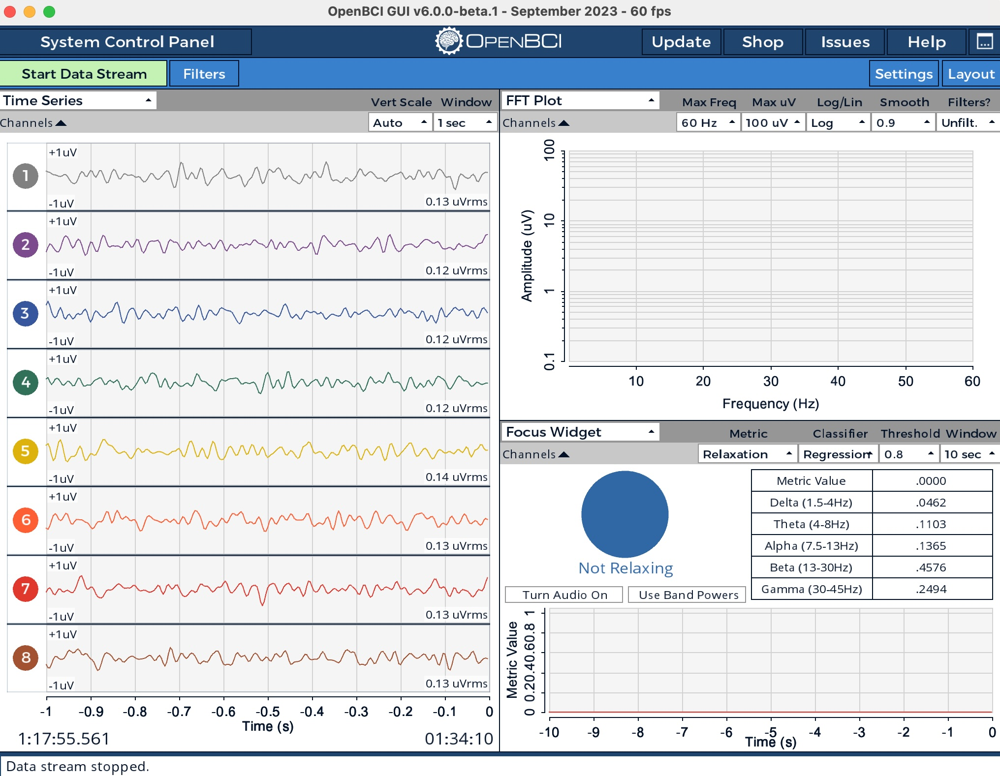</a>

**ESP-EEG V2, all inputs shorted with BIAS connected, GUI filters off.** All eight channels read **0.12–0.14 µVrms** (±1 µV vertical scale, 1 s window).

| Channel | 1 | 2 | 3 | 4 | 5 | 6 | 7 | 8 |
|---------|---|---|---|---|---|---|---|---|
| **Noise (µVrms)** | 0.13 | 0.12 | 0.12 | 0.12 | 0.14 | 0.13 | 0.13 | 0.13 |

#### 16CH ESP-EEG

<a href="16ch_noisefloor.jpg">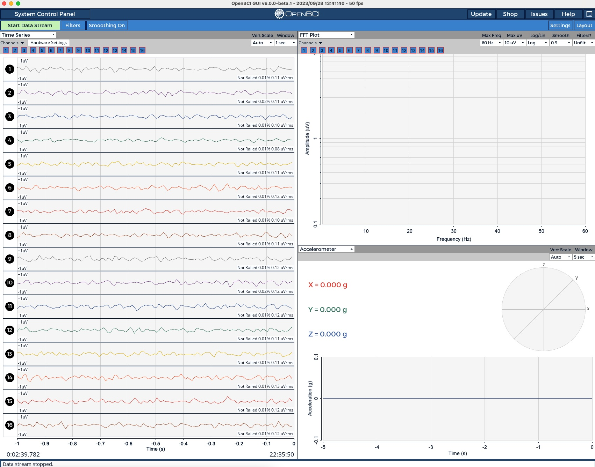</a>

**16CH ESP-EEG, all inputs shorted with BIAS connected, GUI filters off.** All sixteen channels read **0.08–0.13 µVrms** (±1 µV vertical scale, 1 s window).

| Channel | 1 | 2 | 3 | 4 | 5 | 6 | 7 | 8 |
|---------|---|---|---|---|---|---|---|---|
| **Noise (µVrms)** | 0.11 | 0.11 | 0.10 | 0.08 | 0.11 | 0.12 | 0.10 | 0.11 |

| Channel | 9 | 10 | 11 | 12 | 13 | 14 | 15 | 16 |
|---------|---|---|---|---|---|---|---|---|
| **Noise (µVrms)** | 0.12 | 0.12 | 0.12 | 0.11 | 0.11 | 0.13 | 0.12 | 0.12 |

<b>Future testing: noise with simulated electrodes</b>

 

**Setup:** CH1 and SRB1 each connected to a common point through a standard simulated electrode load of **51 kΩ in parallel with 47 nF** (0.047 µF). BIAS is not connected. No signal is applied.

In real use, each input sees an electrode on the skin, which behaves like a resistance in parallel with a capacitance, and the ESP-EEG's input filter is designed around that kind of source. The two loads' own thermal noise (about 0.27 µVrms over 1–50 Hz) is included in the result, so this figure reflects real-use conditions.

**Reference standard.** The international standard for EEG equipment is IEC 60601-2-26 (since 2019, IEC 80601-2-26). Its input noise test (clause 201.12.1.101.3 in the 2012 edition) measures noise with a simulated electrode impedance in place, not a dead short. It requires noise referred to the input to stay within **6 µV peak-to-valley**.

**Procedure:** connect CH1 and SRB1 to a common point, each through a 51 kΩ ∥ 47 nF load, with BIAS unconnected. Then follow steps 2–4 above.

| | With simulated electrodes |
|---|---|
| **Input** | 51 kΩ ∥ 47 nF on CH1 and SRB1 |
| **BIAS** | Not connected |
| **Channels tested** | 1 |
| **Bandwidth** | 1–50 Hz |
| **Noise (RMS)** | _TBD_ |
| **Noise (peak-to-valley)** | _TBD_ |
| **IEC 80601-2-26 limit** | 6 µV peak-to-valley |

---

## 3. Common-Mode Rejection Ratio (CMRR)

**135 dB (V2) and 140 dB (16CH) on channel 1, at least 25 dB above the ADS1299's own 110 dB minimum spec.** Out of a 2 V common-mode signal, only 0.25 µV (V2) and 0.14 µV (16CH) gets through.

**What it measures:** Each ESP-EEG channel is a differential input: it records the *difference* between CH+ (the channel input) and CH− (SRB1). Mains hum couples onto the whole body, so it shows up almost equally on CH+ and CH−. In theory, subtracting the two cancels it completely. In practice, small tolerance differences between the components on CH+ and CH− keep the cancellation from being perfect, so a tiny fraction gets through.

CMRR measures that fraction: how much smaller the leaked signal is than the signal applied to both inputs. Higher is better. For example, 120 dB means only one part in a million gets through.

### Test setup

Channel 1 is a differential pair: the CH1 input is CH1+, and SRB1 is CH1−. The two are tied together and driven by the same sine wave, measured against the board's ground. CH1+ and CH1− then see an identical signal, so an ideal device would read zero. Whatever the ESP-EEG does read at the test frequency is the leakage.

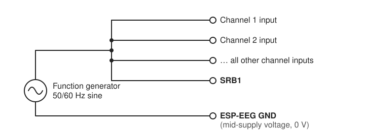

<table>
  <tr>
    <th align="center">ESP-EEG V2 setup</th>
    <th align="center">16CH ESP-EEG setup</th>
  </tr>
  <tr>
    <td align="center"><a href="cmrr_testset.jpg">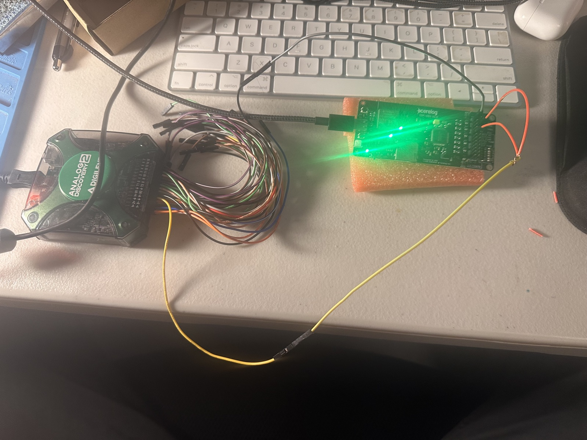</a></td>
    <td align="center"><a href="16chcmrrset.jpg">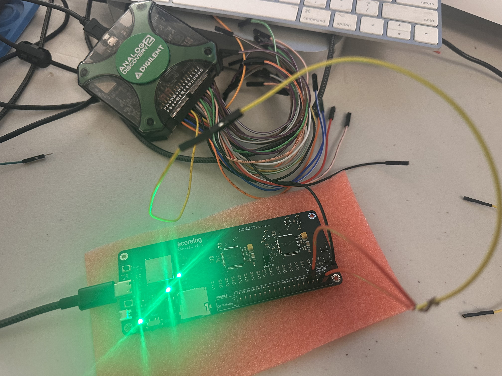</a></td>
  </tr>
</table>

**Bench setup (both boards):** Digilent Analog Discovery 2 driving CH1 and SRB1 together on the ESP-EEG under test. Open bench, no shielded enclosure.

### Procedure

1. **Wire the channel input under test (CH1) and SRB1 together** and connect them to the generator output. Turn the other channels off.
2. **Connect the generator's ground to the ESP-EEG GND (mid-supply voltage, 0 V).** The ESP-EEG runs from ±2.5 V, so GND sits halfway between the rails and the signal stays centered in the ADS1299's input range.
3. **Power the ESP-EEG over USB or battery.** The results below were measured over USB, with the ESP-EEG and generator connected to the same computer.
4. **Leave the BIAS pin unconnected** (or turn BIAS off). BIAS cancels common-mode signals by driving its output back into the body; with nothing connected to it, it can't affect the inputs.
5. **Set the generator to a sine at your mains frequency** (50 or 60 Hz), with an amplitude of up to 2 V and no DC offset.
6. **Convert the applied signal (Vcm) to RMS.** For a sine, RMS = amplitude × 0.707, so 2 V amplitude = 1.41 Vrms.
7. **Record 30–60 s** with the ESP-EEG.
8. **Take the FFT** and read the height of the peak at the test frequency on each channel, in µVrms. This is Vleak.

### Calculation

$$
\text{CMRR (dB)} = 20 \log_{10}\left(\frac{V_{cm}}{V_{leak}}\right)
$$

Use RMS for both values.

**ESP-EEG V2, channel 1:** 2 V amplitude (1.41 Vrms) applied at 50 Hz, 0.25 µV leaks through:

$$
\frac{1.414\ \text{V}}{0.25\ \mu V} = 5\,657\,000 \quad\Rightarrow\quad 20 \log_{10}(5\,657\,000) = \mathbf{135\ dB}
$$

**16CH ESP-EEG, channel 1:** 2 V amplitude (1.41 Vrms) applied at 50 Hz, 0.14 µV leaks through:

$$
\frac{1.414\ \text{V}}{0.14\ \mu V} = 10\,100\,000 \quad\Rightarrow\quad 20 \log_{10}(10\,100\,000) = \mathbf{140\ dB}
$$

**Reference:** the ADS1299 datasheet specifies a minimum CMRR of 110 dB at the chip, at 50 and 60 Hz.

### Results

<table>
  <tr>
    <th align="center">ESP-EEG V2</th>
    <th align="center">16CH ESP-EEG</th>
  </tr>
  <tr>
    <td align="center"><a href="cmrr.jpg">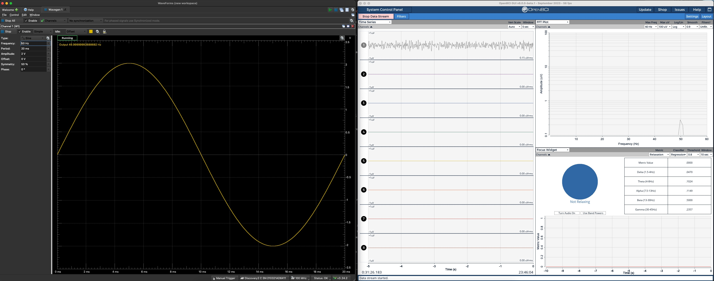</a></td>
    <td align="center"><a href="16chcmrr.jpg">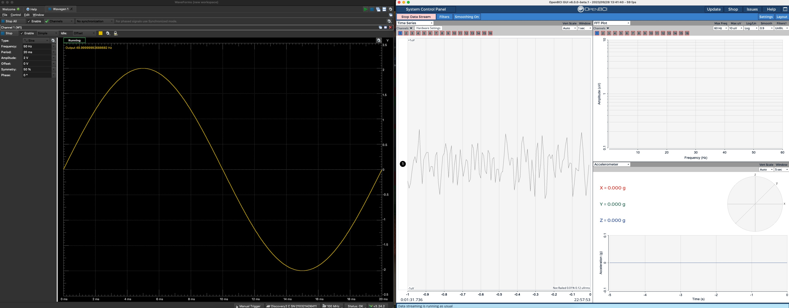</a></td>
  </tr>
  <tr>
    <td>Only a <b>0.25 µV</b> peak appears at 50 Hz. Channels 2–8 were turned off.</td>
    <td>Only a <b>0.14 µV</b> peak appears at 50 Hz. Channels 2–16 were turned off.</td>
  </tr>
</table>

In each screenshot, **left:** function generator output, a 50 Hz sine at 2 V amplitude, applied to both CH1+ and SRB1. **Right:** ESP-EEG recording with all GUI filters off. Only CH1 and SRB1 were driven. BIAS was enabled but its pin was left unconnected, so it had no path to the inputs. Click an image to enlarge.

| Board | Channel | Vcm applied (RMS) | Vleak measured | CMRR |
|-------|---------|------------------------------|---------------------------|------|
| ESP-EEG V2 | 1 | 1.41 Vrms (2 V amplitude, 50 Hz) | 0.25 µV | **135 dB** |
| 16CH ESP-EEG | 1 | 1.41 Vrms (2 V amplitude, 50 Hz) | 0.14 µV | **140 dB** |

The 0.25 µV leakage is the FFT peak height, used directly as Vleak. Any conversion of a peak reading to RMS would make Vleak smaller and the CMRR higher, so 135 dB is a conservative figure. Similar performance was measured at 60 Hz, so the result holds at both mains frequencies. Remaining channels: testing in progress.

**Why it's this high:** the ESP-EEG V2 and 16CH both use a common-mode and a differential input filter, the arrangement TI recommends for the ADS1299. A small capacitor to ground on each leg handles common-mode filtering, and one larger capacitor across CH+ and CH− does the differential filtering. Keeping the per-leg capacitors small means component tolerances turn far less common-mode signal into a differential error. Most ADS1299 boards filter each leg to ground only, and published measurements of other open-source ADS1299 boards range from about 80 to 110 dB ([ironbci](https://arxiv.org/abs/2111.03656), [Creamino](https://www.researchgate.net/publication/326818755_Creamino_A_Cost-Effective_Open-Source_EEG-Based_BCI_System), [BEATS](https://arxiv.org/abs/2203.02102)).

---

_The ESP-EEG is not a medical device. These measurements are for engineering characterization only._
