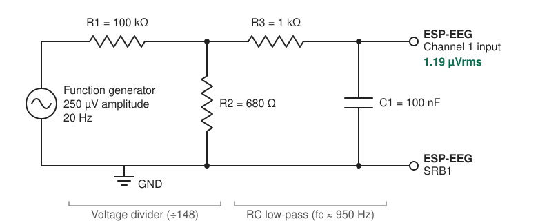
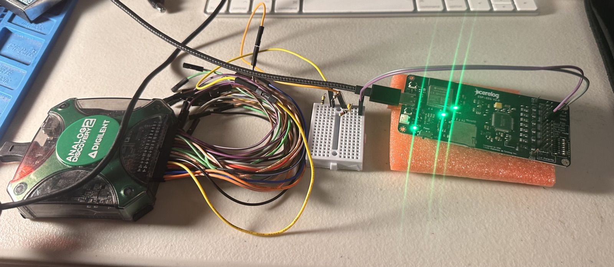
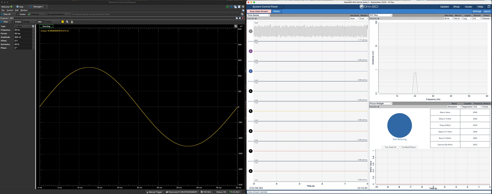
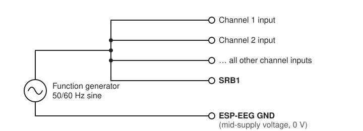
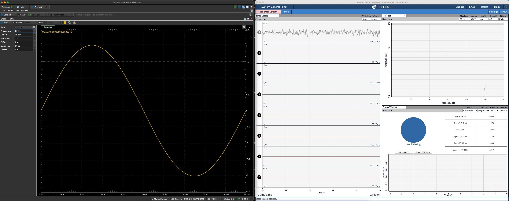

# ESP-EEG Characterization

Bench measurements of the ESP-EEG analog front end, all physically tested on an open bench with no shielding.

| | Result |
|---|---|
| **Microvolt accuracy** | A 1.19 µVrms input read back as **1.17 µVrms**, within 2% |
| **Common-mode rejection** | **135 dB** at 50 Hz: a 2 V common-mode signal is cut to 0.25 µV, a reduction of more than 5 million times |
| **vs. other open-source ADS1299 boards** | Published CMRR results range from about 80 to 110 dB. The ESP-EEG beats the top of that range by 25 dB, roughly 18 times better rejection |

1. [1.19 µVrms Input Test](#1-119-µvrms-input-test)
2. [Noise Floor](#2-noise-floor)
3. [Common-Mode Rejection Ratio (CMRR)](#3-common-mode-rejection-ratio-cmrr)

---

## 1. 1.19 µVrms Input Test

The ESP-EEG was **physically tested on the bench with a 1.19 µVrms, 20 Hz input signal, proving it can resolve microvolt-level signals.** It measured **1.17 µVrms**, within 2% of the expected value, with a clean 20 Hz peak in the spectrum. Typical scalp EEG signals are roughly 10–100 µV, so this is well below the level of the signals the device is built to record.

### Test setup

The test circuit is adapted from the test setup in the Texas Instruments ADS1299 datasheet. It uses the same circuit topology TI uses to characterize the chip, with component values adjusted for the function generator and parts used here.

Function generators can't output microvolt-level signals cleanly; at that level their own noise is bigger than the signal. So the generator (Digilent Analog Discovery 2) was set to 250 µV amplitude and reduced with a precision resistive divider (÷148), followed by an RC low-pass filter that removes high-frequency noise and RF pickup from the generator. The signal was fed into channel 1, referenced to SRB1. Bias was not connected, since this is a direct input test.

**Bench setup:** Digilent Analog Discovery 2 (left), voltage divider and RC filter on a breadboard (center), ESP-EEG V2 (right). Open bench, no shielded enclosure.

### Signal at the input

**Voltage divider**

$$
\frac{V_{out}}{V_{in}} = \frac{R_2}{R_1 + R_2} = \frac{680}{100\,000 + 680} = \frac{1}{148}
$$

$$
\frac{250\ \mu V}{148} = 1.69\ \mu V \text{ amplitude}
$$

**Amplitude to RMS**

$$
1.69\ \mu V \times 0.707 = \mathbf{1.19\ \mu V_{RMS}}
$$

**RC filter**

$$
f_c = \frac{1}{2\pi \,(675 + 1000)\,\Omega \times 100\ \text{nF}} \approx 950\ \text{Hz}
$$

The filter sees the divider's 675 Ω source resistance in series with R3. At 20 Hz it has no meaningful effect on the amplitude, so the signal at the input is **1.19 µVrms**.

| Stage | Signal |
|-------|--------|
| Function generator | 250 µV amplitude |
| After divider (÷148) | 1.69 µV amplitude |
| **At ESP-EEG input** | **1.19 µVrms** |

### Result

**Left:** function generator output, a 20 Hz sine at 250 µV amplitude, before the ÷148 divider. **Right:** ESP-EEG V2 recording. Channel 1 reads **1.17 µVrms**, and the FFT shows a single clear peak at 20 Hz. Channels 2–8 were turned off for a clean display. A 50/60 Hz notch filter was on in the GUI; the measured value is the same with it off.

| | Expected | Measured |
|---|----------|----------|
| Signal at ESP-EEG input | 1.19 µVrms | **1.17 µVrms** |
| Frequency | 20 Hz | 20 Hz |
| Difference | | 1.7% (within resistor tolerance) |

---

## 2. Noise Floor

**What it measures:** The smallest signal level the ESP-EEG can distinguish, set by its own internal noise with no signal applied. Lower is better.

### Test setup

Every channel input is connected to SRB1 through a small resistor (a few ohms, e.g. 2.2 Ω). No signal is applied. Bias is not connected.

Two details matter for an accurate result:

- **Use a resistive load, not a bare jumper wire.** On the V2 and 16-channel boards, a differential filter capacitor sits across each input pair. A bare jumper's own wire inductance forms a resonant loop with that capacitor, which adds energy from the test fixture to the measurement. A few ohms damps this out, and its own thermal noise is negligible (≈ 0.2 nV/√Hz). Real electrodes present kilohms of impedance, so this only arises with a near-zero-ohm test short, never in use. EEG noise standards such as IEC 60601-2-26 likewise measure noise with a simulated electrode impedance in place, not a dead short.
- **Terminate every channel, not just the one under test.** A floating input can drift to several volts, and a signal that large can couple into neighboring channels and raise their apparent noise floor. This applies to any high-impedance multichannel EEG amplifier, so connect all inputs to SRB1 the same way before measuring.

### Procedure

1. **Connect every channel input to SRB1** through a resistor of a few ohms.
2. **Run the ESP-EEG on battery** with no USB connection to a computer.
3. **Record 30–60 s** with the ESP-EEG.
4. **Band-pass filter the recording** to the EEG band (e.g. 1–50 Hz).
5. **Take the RMS** of the filtered recording on each channel. This is the noise floor, in µVrms.

### Results

| Channel | Bandwidth | Noise floor (RMS) |
|---------|-----------|-------------------|
| 1 | _TBD_ | _TBD_ |

---

## 3. Common-Mode Rejection Ratio (CMRR)

**135 dB on channel 1, 25 dB above the ADS1299's own 110 dB minimum spec.** Out of a 2 V common-mode signal, only 0.25 µV gets through.

**What it measures:** Each ESP-EEG channel is a differential input: it records the *difference* between CH+ (the channel input) and CH− (SRB1). Mains hum couples onto the whole body, so it shows up almost equally on CH+ and CH−. In theory, subtracting the two cancels it completely. In practice, small tolerance differences between the components on CH+ and CH− keep the cancellation from being perfect, so a tiny fraction gets through.

CMRR measures that fraction: how much smaller the leaked signal is than the signal applied to both inputs. Higher is better. For example, 120 dB means only one part in a million gets through.

### Test setup

The channel input under test (CH1) and SRB1 are tied together and driven by the same sine wave, measured against the board's ground. The channel then sees an identical signal on both of its inputs, so an ideal device would read zero. Whatever the ESP-EEG does read at the test frequency is the leakage.

### Procedure

1. **Wire the channel input under test (CH1) and SRB1 together** and connect them to the generator output. Turn the other channels off.
2. **Connect the generator's ground to the ESP-EEG GND (mid-supply voltage, 0 V).** The ESP-EEG runs from ±2.5 V, so GND sits halfway between the rails and the signal stays centered in the ADS1299's input range.
3. **Power the ESP-EEG over USB or battery.** The results below were measured over USB, with the ESP-EEG and generator connected to the same computer.
4. **Leave the BIAS pin unconnected** (or turn BIAS off). BIAS cancels common-mode signals by driving its output back into the body; with nothing connected to it, it can't affect the inputs.
5. **Set the generator to a sine at your mains frequency** (50 or 60 Hz), with an amplitude of up to 2 V and no DC offset.
6. **Convert the applied signal (Vcm) to RMS.** For a sine, RMS = amplitude × 0.707, so 2 V amplitude = 1.41 Vrms.
7. **Record 30–60 s** with the ESP-EEG.
8. **Take the FFT** and read the height of the peak at the test frequency on each channel, in µVrms. This is Vleak.

### Calculation

$$
\text{CMRR (dB)} = 20 \log_{10}\left(\frac{V_{cm}}{V_{leak}}\right)
$$

Use RMS for both values.

**ESP-EEG V2, channel 1:** 2 V amplitude (1.41 Vrms) applied at 50 Hz, 0.25 µV leaks through:

$$
\frac{1.414\ \text{V}}{0.25\ \mu V} = 5\,657\,000 \quad\Rightarrow\quad 20 \log_{10}(5\,657\,000) = \mathbf{135\ dB}
$$

**Reference:** the ADS1299 datasheet specifies a minimum CMRR of 110 dB at the chip, at 50 and 60 Hz.

### Results

**Left:** function generator output, a 50 Hz sine at 2 V amplitude, applied to both CH1+ and SRB1. **Right:** ESP-EEG V2 recording with all GUI filters off. Out of a 2 V common-mode signal, only a 0.25 µV peak appears at 50 Hz. Only CH1 and SRB1 were driven; channels 2–8 were turned off. BIAS was enabled but its pin was left unconnected, so it had no path to the inputs.

| Channel | Vcm applied (RMS) | Vleak measured | CMRR |
|---------|------------------------------|---------------------------|------|
| 1 | 1.41 Vrms (2 V amplitude, 50 Hz) | 0.25 µV | **135 dB** |

The 0.25 µV leakage is the FFT peak height, used directly as Vleak. Any conversion of a peak reading to RMS would make Vleak smaller and the CMRR higher, so 135 dB is a conservative figure. Remaining channels: testing in progress.

**Why it's this high:** the ESP-EEG V2 uses both a common-mode and a differential input filter, the arrangement TI recommends for the ADS1299. A small capacitor to ground on each leg handles common-mode filtering, and one larger capacitor across CH+ and CH− does the differential filtering. Keeping the per-leg capacitors small means component tolerances turn far less common-mode signal into a differential error. Most ADS1299 boards filter each leg to ground only, and published measurements of other open-source ADS1299 boards range from about 80 to 110 dB ([ironbci](https://arxiv.org/abs/2111.03656), [Creamino](https://www.researchgate.net/publication/326818755_Creamino_A_Cost-Effective_Open-Source_EEG-Based_BCI_System), [BEATS](https://arxiv.org/abs/2203.02102)).

---

_The ESP-EEG is not a medical device. These measurements are for engineering characterization only._
