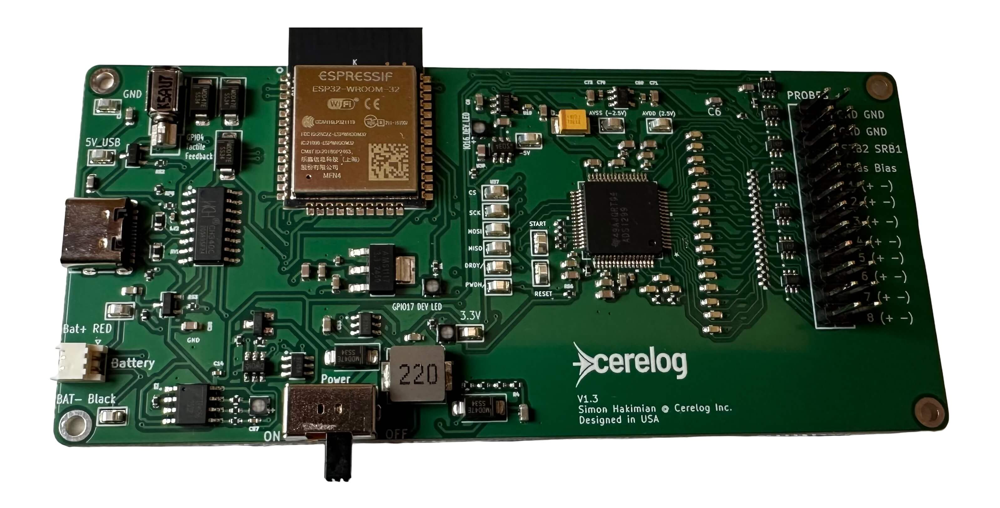
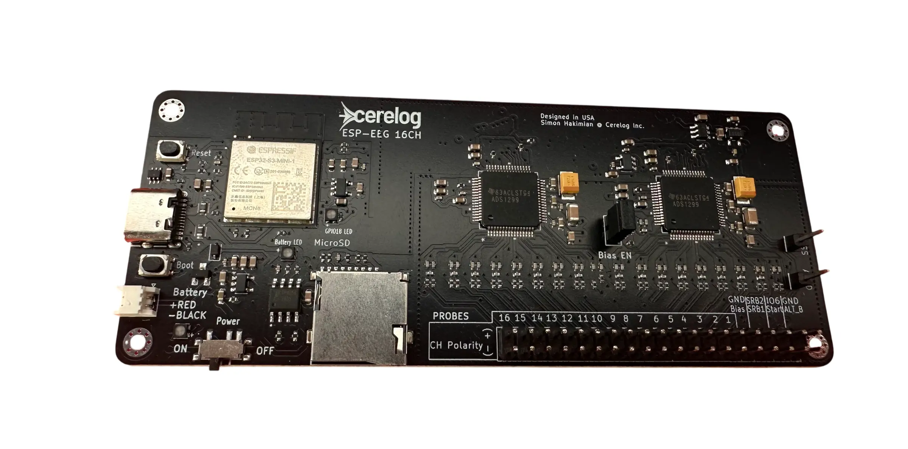

# ESP EEG: Quick Start & Software Guide

**⚠️ Note: Full instructions for the device are included in the PDF manual 'product_use_guide_1_6.pdf' which can also be found [here](https://www.cerelog.com/eeg_researchers_guide.html) and I reccomend you read them as they are very detailed. This guide provides the essential steps to quickly get the device running, connected, and plotting data.**

# Need Help or have a question? 

[Discord Chat Community](https://discord.com/invite/fVYf44JTua) 
or email simon@cerelog.com 

**[Troubleshooting guide:](https://github.com/Cerelog-ESP-EEG/Troubleshooting_connection/tree/main )**


---


# 🔌 Part 1: Connecting Hardware & Running a Session


## 📋 Which board do you have? (Read this first)

There are three ESP-EEG boards, and a few instructions differ between them. Check this table before following the rest of the guide.

| | **ESP-EEG V1 (8CH)** | **ESP-EEG V2 (8CH)** | **ESP-EEG 16-Channel** |
|---|---|---|---|
| Channels | 8 | 8 | 16 |
| Montage selection | Firmware edit + reflash | **Physical slider switch on the PCB** | **Two slider switch banks on the back of the board** |
| microSD recording | ❌ No card slot | ✅ Onboard microSD slot | ✅ Onboard microSD slot |
| Onboard haptic motor | ✅ Yes | ❌ Removed | ❌ Removed |
| USB driver install | Sometimes (CH340C / CH341SER) | ❌ Not required | ❌ Not required |

The **Part 2** software setup (building BrainFlow, filtering, plotting) is the same procedure on every board. Note that the example scripts in this guide are written for 8 channels and use `BoardIds.CERELOG_X8_BOARD` — 16-Channel users may need to adjust the channel count and plot layout in the scripts.

## 1. Hardware Assembly
Connect your EEG cap cable(s) to the required touch-proof adapter(s), then plug the adapter(s) into the electrode headers on the Cerelog board.

## 2. Prepare the Subject
Fit the EEG cap on the subject's head. Apply a small amount of conductive gel into each electrode cavity to ensure good skin contact.

## ⚠️ CRITICAL SAFETY REMINDER — READ BEFORE CONNECTING ANYTHING

**This board has no medical-grade isolation.** As per the safety notice in Section 1 of the full product guide, only connect the device to a laptop running on its own **battery power**.

*   **DO NOT** use this device if the laptop is charging.
*   **DO NOT** connect this device to a desktop computer plugged into a wall outlet.

---

## 3a. How to connect the circuit board (what pins do what):

Full illustrated version on the website: [Hardware Overview](https://www.cerelog.com/eeg_researchers_guide.html#hardware-overview)

**Pick the section for your board — V1 and V2/16CH are wired differently.**

<details>
<summary><b>🟦 ESP-EEG V1 (8-Channel) — click to expand</b></summary>

<br>

### EEG Setup (Scalp Recording)

*   **SRB1 pin** — This is the negative (–) reference electrode for all 8 channels. Attach an earclip electrode to one ear. Apply conductive gel under the earclip for a good connection.
*   **BIAS pin** — Attach a second earclip electrode to the other ear, also with conductive gel.
*   **CH1+ through CH8+** — Connect these to your headset electrodes of choice. These are the only channel pins you need for a standard EEG setup.
*   **CH1– through CH8–** — Leave these unconnected. In the default firmware configuration these pins are not tied to SRB1 and are not used. Only connect them if you change the montage by editing and reflashing the firmware.

> **Tip:** If you run into signal quality issues, give the **GND** pin a try in place of the BIAS pin on the second earclip — it may help.

> **Is your session starting out flat?** Try starting the session with the **GND** pin connected to your earclip and then swap over to the **BIAS** pin once the session is running. This can help with feedback loop stabilization.

### EMG Setup (Muscle Recording)

To record one channel of EMG data (e.g. forearm muscles):

*   **CH1+** — Place on the top of the forearm (over the muscle belly).
*   **SRB1** — Place on the bottom of the forearm as the negative (–) reference.
*   **GND pin** — Place on the elbow. For EMG, the GND pin works best as the ground reference rather than the BIAS pin.

### ⚠️ Not Using All 8 Channels?

For best results, all 8 channels should be in use. If you are using fewer than 8 channels, you should either **tie the unused CH+ pins to one of the active CH+ pins** (connect them together physically), or **disable the unused channels in the firmware** and reflash the board.

If unused channels are left floating (unconnected and enabled), the BIAS pin will be less effective at eliminating noise, resulting in **poorer signal quality across all channels**.

</details>

<details>
<summary><b>🟩 ESP-EEG V2 (8-Channel) & 16-Channel — click to expand</b></summary>

<br>

These boards support **both** a referential montage (SRB1) and a differential montage (CH+ / CH–), and you choose between them with the **physical slider switch(es) on the PCB — not in software.**

### Choose Your Path: Set the Switch, Then Wire It

The montage is selected by the slider switch on the PCB, and the switch position determines how you wire your electrodes. Pick one of the two paths below and follow it end to end — **they are mutually exclusive.**

> **⚠️ Tip:** The montage switches are deliberately stiff and hard to move with your fingers. Use a **sewing pin or the tip of a pencil** and slide them slowly and carefully into position — **do not force them.** 16-Channel boards have **two montage switch banks on the back of the board** instead of one; **both must be set to the same mode**, whichever path you take.

---

#### Path A — Referential Montage (SRB1)

**Best for:** scalp EEG and most EMG. This is the standard mode.

**1. Set the switch:** move **all switches to the right**. This puts the board in SRB1 referential montage mode. On 16-Channel boards, set **both** switch banks to the right.

**2. Wire your electrodes:** in this mode SRB1 is the shared negative (–) reference for every channel, and BIAS drives noise cancellation. A two-channel example:

*   **CH1+ and CH2+** — connect to your two recording sites (scalp electrodes for EEG, or over the muscle belly for EMG).
*   **SRB1** — connect to one earclip electrode, with conductive gel. This is the negative (–) reference shared by both channels.
*   **BIAS** — connect to the earclip on the other ear, also with conductive gel.
*   **CH1– through CH8–** (CH16– on 16-Channel boards) — leave these **unconnected** in referential mode.

The same pattern scales to any number of channels: every CH+ you use goes to a recording site, SRB1 to one earclip, BIAS to the other.

---

#### Path B — Differential Montage (CH+ / CH–)

**Best for:** measuring between two specific points, such as a single muscle in EMG.

**1. Set the switch:** move the switches to the **opposite position (not to the right)**. Each channel then measures between its own CH+ and CH– pins instead of against the shared SRB1 reference. On 16-Channel boards, set **both** switch banks the same way.

**2. Wire your electrodes:**

*   **CH1+ and CH1–** — connect this pair across the two points you want to measure between. Repeat per channel: CH2+ / CH2–, CH3+ / CH3–, and so on.
*   **SRB1** — not used as the reference in this mode.
*   **BIAS** — still connect it (see the BIAS pin note below); noise cancellation works the same way in both modes.

---

### 🚨 CH1 Must Always Be Connected (both paths)

**CH1 is the minimum electrode that must be attached to the user.** You cannot, for example, record three channels using only channels 2, 3 and 4 — one of the channels you use must physically be **CH1**. The BIAS pin stabilises the signal and removes noise through a feedback loop that **runs through Channel 1**, so without CH1 connected the BIAS circuit has nothing to work against.

For the same reason, **a poor CH1 connection degrades BIAS performance across every channel.** Give CH1 the best, lowest-impedance contact of all your electrodes — plenty of conductive gel and a firm, stable placement.

### One Register to Leave As-Is: SRB1 Enable

Montage selection on V2 and 16-Channel boards is handled by the **slider switch on the PCB**, so the SRB1 enable bits are set in firmware to work with that switch and **should be left at their default value**. If you want to switch between referential and differential mode, **move the switch** rather than changing this register — toggling SRB1 enable in firmware will not select a montage on these boards. The rest of the firmware is yours to modify as usual.

### A Note on the BIAS Pin: BIAS_EN Header & Alternative Bias Options

*   **BIAS_EN header** — must be in place (jumper installed) for the BIAS pin to work. This is the normal configuration for EEG and for most EMG.
*   **ALT_B pin** — for some niche EMG applications, ALT_B may work as an alternative bias pin. It can **only** be used with the BIAS_EN header **removed**.
*   **GND pin** — a third option worth trying for EMG. Expect worse performance than BIAS or ALT_B; its purpose is to keep the subject near the centre of the supply so readings stay within the board's rail limits.

### Optional: AVDD & AVSS Header Pins (Powering Active Electrodes)

The board exposes **AVDD** and **AVSS** header pins, which connect to the ADC supply's **+2.5 V and –2.5 V** inputs. If you are using ThinkPulse active electrodes, you can power them from the board's own supplies through these pins. *Cerelog is not affiliated with ThinkPulse.*

### 16-Channel Boards

Every rule above applies identically — there are simply **16 channels instead of 8**, and **two montage switch banks on the back of the board** rather than one.

</details>

## 3b: (For V2 and 16CH devices) Info on using microsd card for data collection

Full version on the website: [Hardware Overview](https://www.cerelog.com/eeg_researchers_guide.html#hardware-overview)

<details>
<summary><b>💾 Recording to microSD (ESP-EEG V2 & 16-Channel only) — click to expand</b></summary>

<br>

The ESP-EEG **V2** and **16-Channel** boards include an onboard microSD card slot, which the original V1 board does **not** have. It lets you record a session directly to a card on the board instead of streaming to a computer.

### ⚠️ Insert the Card Before You Power On

The microSD card **must already be inserted before you turn the device on** with the power switch. The card is detected at **start-up only** — inserting it after the board is powered will not start a recording.

### Choosing a Card

*   **Capacity:** most cards of **32 GB or less** will work, provided they are **FAT32** formatted. Cards larger than 32 GB, or cards using a different file system, may not work.
*   **Wrong format or too large?** You can reformat the card with your computer's disk utility — aim for a **FAT32 volume of 32 GB or under**.
*   **High-endurance cards are recommended for long recording runs.** They significantly reduce the risk of file corruption or interruption over many hours of continuous writing.

### What Gets Recorded

Each run produces **one CSV file** on the card. Every row is one sample, with the following columns:

*   **Timestamp** — milliseconds since the log started (**not** wall-clock time).
*   **Status** — the 3-byte status word emitted by the ADS1299 with every sample, written in hex. It carries the ADC's sync pattern along with lead-off and GPIO flags.
*   **CH1 … CH8** — one column per channel, holding **signed ADC counts** (raw 24-bit conversion results, **not volts**). On 16-Channel boards this runs **CH1 … CH16** instead.

So a row reads:

```
timestamp_ms, status_hex, ch1, ch2, … ch8      (or … ch16)
```

### Converting ADC Counts to Voltage

The channel columns are raw signed ADC counts. To convert them (V = 4.5 V, gain = 24 by default):

```python
scale_factor = (2 * 4.5 / 24) / (2**24)   # = 2.2352e-8 V per count
microvolts = raw_val * scale_factor * 1000000
```

### 🚨 Verify Your Recording Before a Long Run

**You are responsible for confirming that data collection is actually in progress.**

Before committing to a long or overnight session, do a short test run first: power the board with the card inserted, record for a minute, then check that the CSV exists on the card and contains sensible data. It is far better to catch a bad card, a bad format, or a loose electrode in a one-minute test than after eight hours of recording.

</details>

## 3c. Advice on Collecting Clean Data

*   **High-Voltage Spike Fix:** If you see large voltage spikes in your data caused by environmental interference, try starting your session with the **GND** pin on the second earclip instead of the BIAS pin. Once the signal stabilizes, swap the earclip back to the **BIAS** pin — the data should return to normal. This helps the board's internal feedback loop settle and reduces environmental ringing before the BIAS-driven noise cancellation takes over.
*   **Non-Standard Mains Frequency:** The test scripts in the Cerelog test suite (including `filtered_plot.py` and others) have hardcoded notch-filter frequencies for **50 Hz and 60 Hz**, which covers most countries. However, if you live in a region where the power grid suffers from strong frequency instability or operates at a non-standard mains frequency, you will need to manually edit the frequency variable in whichever test script you are using to match your local mains frequency and effectively remove that noise from your recordings.
*   **Use the BIAS probe correctly.** It is the single most important tool for noise cancellation — it measures the mains hum from the body and subtracts it from the EEG channels. Ensure the ear clips used for BIAS and SRB1 have plenty of conductive gel.
*   **Jaw clench looks small? That's normal.** Because of the board's effective BIAS filtering, you may not see massive screen-filling spikes when clenching your jaw, unlike on cheaper or older hardware. It means the board is successfully filtering out the muscle noise.


## 4. Connect the board

## **[Note: If your device (after doing Part 2 instructions below) can't connect the computer to the device, read this helpful [troubleshooting guide:](https://github.com/Cerelog-ESP-EEG/Troubleshooting_connection/tree/main )]**

Connect the board to your computer via USB-C. Wait for green LED to turn on. 

⚠️ Don't see the LED turn on? 
Sometimes you may need to turn on and off PCB for computer to detect new board. If you do not see this status LED turn on after 10 seconds you need to powercycle with switch. Also, if the LIPO battery is dead you will need to charge it with USB-C. After plugging in a new battery you must also turn on and off the power switch.

---

# 💻 Part 2: Software Setup & Advanced Analysis

> **⚠️ Driver installation applies to V1 devices only.** **ESP-EEG V2 and 16-Channel boards do not require driver installation** — modern operating systems detect them automatically. Skip the two driver links below unless you own a V1 (or your Raspberry Pi still fails to see the board).

<table><tr><td>

<details>
<summary><p align="center"><a name="board-photo"></a> <a name="board-photo"></a></p><h1>👉 🟦🟩 V1 and V2 ESP-EEG Software Options (CLICK TO EXPAND)</h1><br><sub>&nbsp; &nbsp; &nbsp; &nbsp; &nbsp; &nbsp; &nbsp; &nbsp; &nbsp; &nbsp; &nbsp; &nbsp; &nbsp; &nbsp; &nbsp; &nbsp; &nbsp; &nbsp; &nbsp; &nbsp; &nbsp; &nbsp; &nbsp; &nbsp; &nbsp; &nbsp; &nbsp; &nbsp; &nbsp; &nbsp; &nbsp; &nbsp; &nbsp; &nbsp; &nbsp; &nbsp; &nbsp; &nbsp; &nbsp; &nbsp; &nbsp; &nbsp; &nbsp; &nbsp; &nbsp; &nbsp; &nbsp; &nbsp; &nbsp; &nbsp; &nbsp; &nbsp; &nbsp; &nbsp; &nbsp; &nbsp; &nbsp; &nbsp; &nbsp; &nbsp; &nbsp; &nbsp; &nbsp; &nbsp; &nbsp; &nbsp; &nbsp; &nbsp; &nbsp; &nbsp; &nbsp; &nbsp; &nbsp; &nbsp; &nbsp; &nbsp; &nbsp; &nbsp; &nbsp; &nbsp; &nbsp; &nbsp; &nbsp; &nbsp; &nbsp; &nbsp; &nbsp; &nbsp; &nbsp; &nbsp; &nbsp; &nbsp; &nbsp; &nbsp; &nbsp; &nbsp; &nbsp; &nbsp; &nbsp; &nbsp; &nbsp; &nbsp; &nbsp; &nbsp; &nbsp; &nbsp; &nbsp; &nbsp; &nbsp; &nbsp; &nbsp; &nbsp; &nbsp; &nbsp; &nbsp; &nbsp; &nbsp; &nbsp; &nbsp; &nbsp; &nbsp; &nbsp; &nbsp; &nbsp; &nbsp; &nbsp; &nbsp; &nbsp; &nbsp; &nbsp; &nbsp; &nbsp; &nbsp; &nbsp; &nbsp; &nbsp; &nbsp; &nbsp; &nbsp; &nbsp; &nbsp; &nbsp; &nbsp; &nbsp; &nbsp; &nbsp; &nbsp; &nbsp; &nbsp; &nbsp; &nbsp; &nbsp; &nbsp; &nbsp; &nbsp; &nbsp; &nbsp; &nbsp; &nbsp; &nbsp; &nbsp; &nbsp; &nbsp; &nbsp; &nbsp; &nbsp; &nbsp; &nbsp; &nbsp; &nbsp; &nbsp; &nbsp; &nbsp; &nbsp; &nbsp; &nbsp; &nbsp; &nbsp; &nbsp; &nbsp; &nbsp; &nbsp; &nbsp; &nbsp; &nbsp; &nbsp; &nbsp; &nbsp; &nbsp; &nbsp; &nbsp; &nbsp; &nbsp; &nbsp; &nbsp; &nbsp; &nbsp; &nbsp; &nbsp; &nbsp; &nbsp; &nbsp; &nbsp; &nbsp; &nbsp; &nbsp; &nbsp; &nbsp; &nbsp; &nbsp; &nbsp; &nbsp; &nbsp; &nbsp; &nbsp; &nbsp; &nbsp; &nbsp; &nbsp; &nbsp; &nbsp; &nbsp; &nbsp; &nbsp; &nbsp; &nbsp; &nbsp; &nbsp; &nbsp; &nbsp; &nbsp; &nbsp; &nbsp; &nbsp; &nbsp; &nbsp; &nbsp; &nbsp; &nbsp; &nbsp; &nbsp; &nbsp; &nbsp; &nbsp; &nbsp; &nbsp; &nbsp; &nbsp; &nbsp; &nbsp; &nbsp; &nbsp; &nbsp; &nbsp; &nbsp; &nbsp; &nbsp; &nbsp; &nbsp; &nbsp; &nbsp; &nbsp; &nbsp; &nbsp; &nbsp; &nbsp; &nbsp; &nbsp; &nbsp; &nbsp; &nbsp; &nbsp; &nbsp; &nbsp; &nbsp; &nbsp; &nbsp; &nbsp; &nbsp; &nbsp; &nbsp; &nbsp; &nbsp; &nbsp; &nbsp; &nbsp; &nbsp; &nbsp; &nbsp; &nbsp; &nbsp; &nbsp; &nbsp; &nbsp; &nbsp; &nbsp; &nbsp; &nbsp; &nbsp; &nbsp; </sub></summary>

**If you own a Raspberry Pi: Driver setup first  -> [Read Here:](https://github.com/Cerelog-ESP-EEG/ESP-EEG/blob/main/Instructions/subguides/raspberrypi/readme.md) (V1 devices only)** 

**Other Linux Users: Driver setup first  -> [CH341SER Driver Here:](https://www.wch-ic.com/downloads/CH341SER_EXE.html)** 

> ⚠️ **Note: These drivers only apply to V1 boards.** V2 boards do not need them.

# *⚠️Option A (NEW and Easy) - [USB or BLE Supported]
## Stream data to Modified OpenBCI GUI + Lab Stream Layer (LSL) python streamer script:

https://github.com/Cerelog-ESP-EEG/How-to-use-OpenBCI-GUI-fork 

**What the guide above shows you (wired, USB):**
1. Plug the board into your computer with a USB cable.
2. Run the LSL Python bridge script. It reads data from the board over USB and sends it out as an LSL stream.
3. Open the OpenBCI GUI fork (linked in the guide) and select that LSL stream to see your data.

**Don't Like USB?: BLE Wireless Support**

You can do the exact same thing without a cable, using Bluetooth (BLE). Follow the <ins>extra instructions</ins> here: [More info](https://github.com/Cerelog-ESP-EEG/WiFi_Support)

They show you how to:
1. Flash the BLE firmware onto the board.
2. Run the BLE LSL Python bridge script (the wireless version of the USB script).
3. Open the same OpenBCI GUI fork and select the LSL stream, just like with USB.


# ⚠️Option B (Best) Brainflow Fork - [USB Supported]


To get the best performance from the ESP EEG, we recommend using our custom BrainFlow instance. This guide covers installation, the theory behind our data stream, and provides a production-grade script for real-time filtering and plotting.

**2 Quick Videos Using Cerelog ESP-EEG with Brainflow:** Use these videos if you get stuck with the GUIDE BELOW. Make sure to read the instructions below though, as the videos don't have all of the setup command scripts.

[ESP-EEG with Brainflow](https://www.youtube.com/watch?v=hLSeSTvoRPI)  and [General Product usage Overview Video](youtube.com/watch?v=6XKdIbguI00&embeds_referring_euri=https%3A%2F%2Fwww.cerelog.com%2F)


# How to use Brainflow [READ THIS!]:

## Step 1: Installation (Custom BrainFlow Instance)

The ESP EEG requires a specific version of BrainFlow to handle its high-fidelity data packets correctly.

1.  **Download the Custom Library:**
    Clone or download the custom BrainFlow repository here:
    👉 **[Cerelog Shared BrainFlow Repository](https://github.com/shakimiansky/Shared_brainflow-cerelog)**

**Seting up the brainflow repo on new computers:**

*   **One-Time Setup:** This compilation is a one-time setup for your computer.
*   **Why compile?** Because the core library is written in C++, it must be compiled specifically for your operating system (Windows, Mac, or Linux).
*   **When to repeat:** You only need to repeat the build process (Step 2) if you modify the underlying C++ source code files (`.cpp`, `.h`). Creating new Python scripts does **not** require a rebuild but it does require running pip install -e. (the last step) before running new python scripts

---

## Step 2: Get the Custom BrainFlow Fork
Our board requires a specific fork of BrainFlow. Clone it and navigate into the new directory.

> **⚠️ IMPORTANT: Use This Specific Repository**
> This version of BrainFlow contains code specific to the Cerelog board. This code has not yet been merged into the official, main BrainFlow repository. You **must** use the link provided below.

```bash
git clone https://github.com/shakimiansky/Shared_brainflow-cerelog.git
cd Shared_brainflow-cerelog
```

---

## Step 3: Build the Library from Source
This crucial step compiles the C++ core of the library.
*Tip: If you make a mistake, manually delete the `build` folder and start this step over.*

### 🍎 macOS and Raspberry Pi/Linux Users: Install Build Tools First
Before proceeding, you need to install Homebrew (a package manager) and CMake. Open a terminal and run these commands one by one:
```bash
/bin/bash -c "$(curl -fsSL https://raw.githubusercontent.com/Homebrew/install/HEAD/install.sh)"
```

macOS only: 
```bash
brew install cmake
```

Raspberry Pi (Linux): Raspberry Pi OS uses apt instead of Homebrew. Install CMake by running:
```bash
sudo apt install cmake
```

### 🛠️ Compilation Steps (All OS)

**1. Create the build directory:**
Create a new directory named `build` inside the `Shared_brainflow-cerelog` folder and navigate into it.
```bash
mkdir build
cd build
```

**2. Prepare build files (Choose your OS):**
Run the correct `cmake` command for your operating system.

*   **For Windows (with Visual Studio 2022):**
    ```bash
    cmake .. -G "Visual Studio 17 2022" -A x64
    ```

*   **For macOS / Linux:**
    ```bash
    cmake ..
    ```

** Run the Build Command:**
This uses 4 processor cores (`-j4`) for faster compilation.
```bash
cmake --build . --config Release --clean-first -j4 -- -k
```

---

## Step 4: Install the Python Package
With the core library built, you must install the Python bindings to link your scripts to the C++ core.

**Raspberry Pi Users: Create a Virtual Environment First**

Raspberry Pi OS requires you to use a Python virtual environment before installing packages. Run these commands before proceeding with the steps below:

​```bash
python3 -m venv ~/cerelog-venv
source ~/cerelog-venv/bin/activate
​```

> **Note:** You will need to re-activate the virtual environment with `source ~/cerelog-venv/bin/activate` each time you open a new terminal session.


## All Users:

**1. Navigate to the python package folder:**
(Move up from the `build` folder and into `python_package`)
```bash
cd ..
cd python_package
```

**2. Install in "Editable" Mode:**
This links the package to the source files, so you don't need to reinstall the pip package if you change python files later. This command only needs to be run once.

*   **Windows / Linux:**
    ```bash
    pip install -e .
    ```
*   **macOS:**
    ```bash
    pip3 install -e .
    ```
## Step 5: Dependencies
Ensure you have the required Python packages installed:
```bash
pip install numpy matplotlib pyserial plotly dash scikit-learn "setuptools<82"
# Note: brainflow must be installed/referenced from the custom repo above
```


## Step 6   Run Test Script

<table>
<tr>
<td>

<details>
<summary>$\Large\textcolor{red}{\textsf{Raspberry Pi Users: Read This First}}$</summary>


### 1. Activate Your Virtual Environment

Before running any test scripts, make sure your virtual environment is active. If you opened a new terminal since Step A.3, re-activate it:

```bash
source ~/cerelog-venv/bin/activate
```

### 2. Hardcode the Serial Port

All BrainFlow test scripts — including `filtered_plot.py` — must have the serial port name hardcoded to run on Raspberry Pi. Automatic port detection does not work on Pi.

In each script, find the line:

```python
params = BrainFlowInputParams()
```

And add the following line directly after it:

```python
params.serial_port = "/dev/ttyCH341USB0"
```

> ⚠️ **Note for V2 and 16CH devices:** These boards do not use the CH341 chip, so `/dev/ttyCH341USB0` will not exist. You need to manually find your board's port name in the terminal (for example, run `ls /dev/tty*` before and after plugging in the board and look for the new entry), then use that port name in the line above.

You must make this edit in **every** BrainFlow test script you want to run on the Pi.

### 3. Running Test Scripts Over SSH

Test scripts that display plots must be run from the Raspberry Pi's own terminal. If you are connected over SSH, the plot window cannot open on your remote machine by default. To run a script over SSH and have the plot display on the Pi's screen, prefix the command with `DISPLAY=:0`:

```bash
DISPLAY=:0 python filtered_plot.py
```

</details>

</td>
</tr>
</table>

## Running the first Brainflow Testscript 

The script below (`filtered_plot.py`)  relies on the bindings found in the Brainflow repository. You must run the script **inside** that repository's environment or install the Python bindings from that source.

Run it by saying python filtered_plot.py or on mac OS python3 filtered_plot.py inside the correct folder

## **[Note: If you can't connect the computer to the device, read this helpful [troubleshooting guide:](https://github.com/Cerelog-ESP-EEG/Troubleshooting_connection/tree/main )]**

##  Run the Script
Below is the complete Python script for robust, real-time plotting. Save this code as `filtered_plot.py` inside your custom BrainFlow folder.

<details>
<summary>🛠️ $\textcolor{red}{\textsf{Troubleshooting: }\texttt{ModuleNotFoundError: No module named 'pkg\_resources'}}$</summary>

<br>

This happens because newer versions of **setuptools** have removed the legacy
`pkg_resources` module. To fix it, downgrade setuptools:

**macOS / Linux**
```bash
python3 -m pip install "setuptools<82"
```

**Windows**
```bash
python -m pip install "setuptools<82"
```

</details>

**Scroll down past the code to learn how it works.**

```python
import time
import numpy as np
import matplotlib.pyplot as plt
from matplotlib.animation import FuncAnimation
from brainflow.board_shim import BoardShim, BrainFlowInputParams, BoardIds, BrainFlowError
from brainflow.data_filter import DataFilter, FilterTypes
from brainflow.data_filter import NoiseTypes, DetrendOperations, AggOperations, WaveletTypes, NoiseEstimationLevelTypes, WaveletExtensionTypes, ThresholdTypes, WaveletDenoisingTypes

# --- Configuration ---
BOARD_ID = BoardIds.CERELOG_X8_BOARD
SECONDS_TO_DISPLAY = 10
UPDATE_INTERVAL_MS = 40
Y_AXIS_PADDING_FACTOR = 1.2

# --- Global variables ---
board = None
eeg_channels = []
sampling_rate = 0
window_size = 0
data_buffer = np.array([])
y_limits = {}

def main():
    """
    Connects to the Cerelog board and creates a robust, real-time, scrolling plot
    with stable filtering and adaptive scaling.
    """
    global board, eeg_channels, sampling_rate, window_size, data_buffer, y_limits

    params = BrainFlowInputParams()
    params.timeout = 15
    board = BoardShim(BOARD_ID, params)

    try:
        eeg_channels = BoardShim.get_eeg_channels(BOARD_ID)
        sampling_rate = BoardShim.get_sampling_rate(BOARD_ID)
        window_size = SECONDS_TO_DISPLAY * sampling_rate

        if sampling_rate <= 0:
            raise BrainFlowError("Could not get a valid sampling rate from the board.", 0)

        for i in range(len(eeg_channels)):
            y_limits[i] = (-100, 100)

        print(f"Connecting to {board.get_board_descr(BOARD_ID)['name']}...")
        print(f"Detected Sampling Rate: {sampling_rate} Hz")
        board.prepare_session()
        print("\nStarting stream... Close the plot window to stop.")
        board.start_stream(5 * 60 * sampling_rate)
        time.sleep(2)

        num_board_channels = BoardShim.get_num_rows(BOARD_ID)
        data_buffer = np.empty((num_board_channels, 0))

        # --- Plot Setup ---
        fig, axes = plt.subplots(4, 2, figsize=(18, 10), sharex=True)
        fig.suptitle('Real-Time Cerelog EEG Waveforms (Correct Time Spacing)', fontsize=16)
        axes_flat = axes.flatten()
        lines = [ax.plot([], [], lw=1)[0] for ax in axes_flat]

        for i, ax in enumerate(axes_flat):
            ax.set_title(f'Channel {eeg_channels[i]}')
            ax.set_ylabel('Voltage (µV)')
            ax.grid(True)
            ax.set_xlim(-SECONDS_TO_DISPLAY, 0)

        fig.text(0.5, 0.04, 'Time (Seconds from "Now")', ha='center', va='center')
        plt.tight_layout(rect=[0, 0.05, 1, 0.96])

        def on_close(event):
            print("Plot window closed, stopping stream...")
            if board and board.is_prepared():
                board.stop_stream()
                board.release_session()
            print("Session released. Exiting.")

        fig.canvas.mpl_connect('close_event', on_close)

        ani = FuncAnimation(fig, update_plot, fargs=(lines, axes_flat), interval=UPDATE_INTERVAL_MS, blit=False)
        plt.show()

    except Exception as e:
        print(f"An error occurred in main(): {e}")
    finally:
        if board and board.is_prepared():
            board.release_session()

def update_plot(frame, lines, axes):
    """
    This function is called periodically to update the plot data.
    """
    global data_buffer, y_limits

    try:
        new_data = board.get_board_data()
        if new_data.shape[1] > 0:
            data_buffer = np.hstack((data_buffer, new_data))
            buffer_limit = int(window_size * 1.5)
            if data_buffer.shape[1] > buffer_limit:
                data_buffer = data_buffer[:, -buffer_limit:]

        plot_data = data_buffer[:, -window_size:]
        
        num_points = plot_data.shape[1]
        if num_points < 2:
            return

        eeg_plot_data = plot_data[eeg_channels] * 1e6
        
        # --- Filtering Logic (Corrected for Real-Time Stability) ---
        for i in range(len(eeg_channels)):
            # Use a safe data length check for the filters
            if eeg_plot_data[i].size > 20: 
                #1 Detrend to get dc offset away
                DataFilter.detrend(eeg_plot_data[i], DetrendOperations.CONSTANT.value)
                # 2. Apply a STABLE 4nd-order low-pass 100hz. This is crucial for real-time processing.
                DataFilter.perform_lowpass(eeg_plot_data[i], sampling_rate, 100.0, 4, FilterTypes.BUTTERWORTH, 0)
                
                # 3. Apply the band-stop (notch) filter for 50, 60 Hz noise.
                DataFilter.perform_bandstop(eeg_plot_data[i], sampling_rate, 48, 52, 3, FilterTypes.BUTTERWORTH, 0)
                DataFilter.perform_bandstop(eeg_plot_data[i], sampling_rate, 58, 62, 3, FilterTypes.BUTTERWORTH, 0)
                
                #4 High Pass above 0.5 Hz
                DataFilter.perform_highpass(eeg_plot_data[i], sampling_rate, 0.5, 4, FilterTypes.BUTTERWORTH, 0)
                
                #5. More cleaning data up
                #DataFilter.perform_rolling_filter(eeg_plot_data[i], 3, AggOperations.MEDIAN.value)
                DataFilter.perform_rolling_filter(eeg_plot_data[i], 3, AggOperations.MEDIAN.value)
                
        # --- Manual Time Axis Generation (for True Scrolling) ---
        time_vector_full_window = np.linspace(-SECONDS_TO_DISPLAY, 0, window_size)
        time_vector_for_plot = time_vector_full_window[-num_points:]
        
        for i, (line, ax) in enumerate(zip(lines, axes)):
            channel_data = eeg_plot_data[i]
            
            # Check for invalid filter output (NaN) to prevent crashes
            if np.isnan(channel_data).any():
                print(f"Warning: NaN detected in channel {eeg_channels[i]} after filtering. Skipping one update.")
                continue
            
            centered_data = channel_data - np.mean(channel_data)
            
            line.set_data(time_vector_for_plot, centered_data)
            
            # --- Adaptive Y-Axis Logic ---
            # Define how many recent samples to use for auto-scaling (last 4 seconds)
            samples_for_scaling = int(4.0 * sampling_rate)
            recent_data = centered_data[-samples_for_scaling:]
            
            if recent_data.size > 0:
                max_val = np.max(recent_data)
                min_val = np.min(recent_data)
            else:
                max_val = np.max(centered_data)
                min_val = np.min(centered_data)
                
            if np.isclose(max_val, min_val):
                max_val += 1; min_val -= 1
                
            target_max = max_val * Y_AXIS_PADDING_FACTOR
            target_min = min_val * Y_AXIS_PADDING_FACTOR
            current_min, current_max = y_limits[i]
            smoothing_factor = 0.1
            new_max = current_max * (1 - smoothing_factor) + target_max * smoothing_factor
            new_min = current_min * (1 - smoothing_factor) + target_min * smoothing_factor
            ax.set_ylim(new_min, new_max)
            y_limits[i] = (new_min, new_max)

    except Exception as e:
        print(f"!!! ERROR IN UPDATE_PLOT: {e}")

if __name__ == "__main__":
    main()
```

# 📘 Part 3: How It Works (High-Level Overview)

*Please view full setup instructions PDF for more detailed instructions on scripting.*

All BrainFlow Python scripts for this board follow a similar pattern. Here is the architecture of a session:

### 1. Initialize and Configure
*   **`params = BrainFlowInputParams()`**: Creates a configuration object. For the Cerelog board over USB, defaults are usually sufficient.
*   **`board_id = BoardIds.CERELOG_X8_BOARD`**: Selects the specific driver for our hardware.
*   **`board = BoardShim(board_id, params)`**: Creates the main controller object.

### 2. Connect and Stream
*   **`board.prepare_session()`**: Finds the board and opens the serial connection.
*   **`board.start_stream()`**: Tells the ESP32 to start collecting data into an internal buffer.
*   **`board.get_board_data()`**: Pulls the data from the buffer into a NumPy array for processing.

### 3. ⚠️ IMPORTANT: Data Scaling
Unlike consumer toys, the Cerelog board provides **raw, unscaled data** to give researchers maximum fidelity. You **must** apply scaling factors to convert these raw values into standard units.

**If you skip this, your graph will look flat **

```python
# --- 1. Scale EEG Data (Vertical Axis) ---
# The board returns data in Volts (V). Convert to microvolts (µV):
eeg_data_microvolts = eeg_data_raw * 1e6

# --- 2. Scale Timestamp Data (Horizontal Axis) [NO CHANGE NEEDED, but read]---
# The board's timestamp is unix seconds. (Firmware sends ms timestamp to Brainflow but no need to touch it because it internally converts to unix seconds. Below is in seconds!) To use and get back seconds from unix seconds:
time_axis_seconds = (timestamps_raw - timestamps_raw[0]) 
```

### 4. Advanced Real-Time Filtering
Reaching clean EEG data requires Digital Signal Processing (DSP). The raw signal contains DC offsets, mains hum (50/60Hz), and movement artifacts.

**The Filtering Chain:**
The script above implements a robust filter chain designed for real-time BCI:
1.  **Detrend:** Removes the DC offset (constant voltage drift) so the signal centers around 0 µV.
2.  **Low-Pass (100Hz):** A 4th-order Butterworth filter that removes high-frequency noise that isn't EEG.
3.  **Band-Stop (Notch):** Specifically cuts out 50Hz and 60Hz noise caused by wall outlets/mains.
4.  **High-Pass (0.5Hz):** Removes extremely slow drifts caused by sweat or head movement.
5.  **Rolling Median:** A final smoothing pass to remove sudden spikes without blurring the signal.

</details>

</td></tr></table>

<table><tr><td>

<details>
<summary><p align="center"><a name="board-photo"></a></p><h1>👉 🟪 16CH ESP-EEG Software Options (CLICK TO EXPAND)</h1><br><sub>&nbsp; &nbsp; &nbsp; &nbsp; &nbsp; &nbsp; &nbsp; &nbsp; &nbsp; &nbsp; &nbsp; &nbsp; &nbsp; &nbsp; &nbsp; &nbsp; &nbsp; &nbsp; &nbsp; &nbsp; &nbsp; &nbsp; &nbsp; &nbsp; &nbsp; &nbsp; &nbsp; &nbsp; &nbsp; &nbsp; &nbsp; &nbsp; &nbsp; &nbsp; &nbsp; &nbsp; &nbsp; &nbsp; &nbsp; &nbsp; &nbsp; &nbsp; &nbsp; &nbsp; &nbsp; &nbsp; &nbsp; &nbsp; &nbsp; &nbsp; &nbsp; &nbsp; &nbsp; &nbsp; &nbsp; &nbsp; &nbsp; &nbsp; &nbsp; &nbsp; &nbsp; &nbsp; &nbsp; &nbsp; &nbsp; &nbsp; &nbsp; &nbsp; &nbsp; &nbsp; &nbsp; &nbsp; &nbsp; &nbsp; &nbsp; &nbsp; &nbsp; &nbsp; &nbsp; &nbsp; &nbsp; &nbsp; &nbsp; &nbsp; &nbsp; &nbsp; &nbsp; &nbsp; &nbsp; &nbsp; &nbsp; &nbsp; &nbsp; &nbsp; &nbsp; &nbsp; &nbsp; &nbsp; &nbsp; &nbsp; &nbsp; &nbsp; &nbsp; &nbsp; &nbsp; &nbsp; &nbsp; &nbsp; &nbsp; &nbsp; &nbsp; &nbsp; &nbsp; &nbsp; &nbsp; &nbsp; &nbsp; &nbsp; &nbsp; &nbsp; &nbsp; &nbsp; &nbsp; &nbsp; &nbsp; &nbsp; &nbsp; &nbsp; &nbsp; &nbsp; &nbsp; &nbsp; &nbsp; &nbsp; &nbsp; &nbsp; &nbsp; &nbsp; &nbsp; &nbsp; &nbsp; &nbsp; &nbsp; &nbsp; &nbsp; &nbsp; &nbsp; &nbsp; &nbsp; &nbsp; &nbsp; &nbsp; &nbsp; &nbsp; &nbsp; &nbsp; &nbsp; &nbsp; &nbsp; &nbsp; &nbsp; &nbsp; &nbsp; &nbsp; &nbsp; &nbsp; &nbsp; &nbsp; &nbsp; &nbsp; &nbsp; &nbsp; &nbsp; &nbsp; &nbsp; &nbsp; &nbsp; &nbsp; &nbsp; &nbsp; &nbsp; &nbsp; &nbsp; &nbsp; &nbsp; &nbsp; &nbsp; &nbsp; &nbsp; &nbsp; &nbsp; &nbsp; &nbsp; &nbsp; &nbsp; &nbsp; &nbsp; &nbsp; &nbsp; &nbsp; &nbsp; &nbsp; &nbsp; &nbsp; &nbsp; &nbsp; &nbsp; &nbsp; &nbsp; &nbsp; &nbsp; &nbsp; &nbsp; &nbsp; &nbsp; &nbsp; &nbsp; &nbsp; &nbsp; &nbsp; &nbsp; &nbsp; &nbsp; &nbsp; &nbsp; &nbsp; &nbsp; &nbsp; &nbsp; &nbsp; &nbsp; &nbsp; &nbsp; &nbsp; &nbsp; &nbsp; &nbsp; &nbsp; &nbsp; &nbsp; &nbsp; &nbsp; &nbsp; &nbsp; &nbsp; &nbsp; &nbsp; &nbsp; &nbsp; &nbsp; &nbsp; &nbsp; &nbsp; &nbsp; &nbsp; &nbsp; &nbsp; &nbsp; &nbsp; &nbsp; &nbsp; &nbsp; &nbsp; &nbsp; &nbsp; &nbsp; &nbsp; &nbsp; &nbsp; &nbsp; &nbsp; &nbsp; &nbsp; &nbsp; &nbsp; &nbsp; &nbsp; &nbsp; &nbsp; &nbsp; &nbsp; &nbsp; &nbsp; &nbsp; &nbsp; &nbsp; &nbsp; &nbsp; &nbsp; &nbsp; &nbsp; &nbsp; &nbsp; &nbsp; &nbsp; &nbsp; &nbsp; &nbsp; &nbsp; &nbsp; </sub></summary>

# *⚠️Option A OpenBCI GUI - [USB or BLE Supported]
## OpenBCI GUI

### 🔌 USB Instructions

> **📊 Sample rate: 125 SPS over USB.** The OpenBCI GUI itself limits a 16-channel USB connection to 125 SPS. For 250 SPS, use the BLE Wireless option below.

Over USB, the 16CH board connects **directly to the main (official) OpenBCI GUI** — no fork or Python script needed.

Download the main OpenBCI GUI here: https://docs.openbci.com/Software/OpenBCISoftware/GUIDocs/

**To connect:**
1. Plug the board into your computer with a USB cable.
2. Open the OpenBCI GUI.
3. Under **Data Source**, select **CYTON**.
4. Select **Serial (from Dongle)**.
5. Select **Manual Connect**.
6. Click the serial port that comes up.
7. Make sure **Channel Count** is set to **16 Channels**.
8. Press **START SESSION**.

<!-- TODO: add photo of OpenBCI GUI connection settings here -->
*📷 [Photo placeholder: OpenBCI GUI connection settings]*

### 📶 BLE Wireless Instructions

**Don't Like USB?: BLE Wireless Support**

> **📊 Sample rate: 250 SPS over BLE.** Streaming through the BLE bridge runs at 250 SPS, double the USB rate.

You can connect the 16CH board to the main OpenBCI GUI without a cable, using Bluetooth (BLE). Get the BLE firmware and the BLE bridge Python script (`.py`) from the <ins>extra instructions</ins> here: [More info](https://github.com/Cerelog-ESP-EEG/WiFi_Support)

> **Why a bridge script?** The main OpenBCI GUI can't read BLE directly. The bridge script connects to the board over BLE and makes it look like an OpenBCI WiFi Shield to the GUI.

**To connect:**
1. Flash the BLE firmware onto the board (from the link above).
2. Run the included BLE bridge Python script (`.py`) from the link above. Leave it running.
3. Open the OpenBCI GUI.
4. Under **Data Source**, select **CYTON**.
5. Select **Wifi (from Wifi Shield)**.
6. Select **16 Channels**.
7. Select **Static IP** and enter **127.0.0.1**.
8. Set the **Sample Rate** to **250**.
9. Press **START SESSION**.

<!-- TODO: add photo of OpenBCI GUI BLE/WiFi connection settings here -->
*📷 [Photo placeholder: OpenBCI GUI WiFi Shield connection settings]*


# ⚠️Option B (Best) Brainflow - [USB or BLE Supported]

<table>
<tr>
<td>

<details>
<summary>$\Large\textcolor{red}{\textsf{Raspberry Pi Users: Read This First}}$</summary>


### 1. Activate Your Virtual Environment

Before running any test scripts, make sure your virtual environment is active. If you opened a new terminal since Step A.3, re-activate it:

```bash
source ~/cerelog-venv/bin/activate
```

### 2. Hardcode the Serial Port

All BrainFlow test scripts — including `filtered_plot.py` — must have the serial port name hardcoded to run on Raspberry Pi. Automatic port detection does not work on Pi.

In each script, find the line:

```python
params = BrainFlowInputParams()
```

And add the following line directly after it:

```python
params.serial_port = "/dev/ttyCH341USB0"
```

> ⚠️ **Note for V2 and 16CH devices:** These boards do not use the CH341 chip, so `/dev/ttyCH341USB0` will not exist. You need to manually find your board's port name in the terminal (for example, run `ls /dev/tty*` before and after plugging in the board and look for the new entry), then use that port name in the line above.

You must make this edit in **every** BrainFlow test script you want to run on the Pi.

### 3. Running Test Scripts Over SSH

Test scripts that display plots must be run from the Raspberry Pi's own terminal. If you are connected over SSH, the plot window cannot open on your remote machine by default. To run a script over SSH and have the plot display on the Pi's screen, prefix the command with `DISPLAY=:0`:

```bash
DISPLAY=:0 python filtered_plot.py
```

</details>

</td>
</tr>
</table>

### 🔌 USB Instructions

> **📊 Sample rate: 125 SPS over USB.** For 250 SPS, use the BLE Wireless option below.

Over USB, the 16CH board works with the **main (official) BrainFlow** — no fork needed. Download BrainFlow here: https://github.com/brainflow-dev/brainflow

Use the board exactly like you would an **OpenBCI Cyton + Daisy over serial**.

**To connect:**
1. Plug the board into your computer with a USB cable.
2. In your BrainFlow script, select the **Cyton + Daisy** board: `BoardIds.CYTON_DAISY_BOARD`.
3. Set the serial port to the board's port (e.g. `COM3` on Windows, `/dev/cu.usbmodem...` on macOS, `/dev/ttyACM0` on Linux).
4. Start the session and stream.

```python
from brainflow.board_shim import BoardShim, BrainFlowInputParams, BoardIds

params = BrainFlowInputParams()
params.serial_port = "COM3"       # change to your board's port

board = BoardShim(BoardIds.CYTON_DAISY_BOARD, params)
board.prepare_session()
board.start_stream()
```

<table><tr><td>

<details>
<summary><h3>👉 📈 Sample Real-Time Plotter Script (Python, USB) (CLICK TO EXPAND)</h3></summary>

A verified working test script that streams all 16 channels over USB and shows a live, filtered, scrolling plot. Run it with `python plotter.py`, or `python plotter.py --serial-port COM3` to set the port yourself.

```python
import argparse
import glob
import sys
import time
import numpy as np
import matplotlib.pyplot as plt
from matplotlib.animation import FuncAnimation
from brainflow.board_shim import BoardShim, BrainFlowInputParams, BoardIds, BrainFlowError
from brainflow.data_filter import DataFilter, FilterTypes
from brainflow.data_filter import NoiseTypes, DetrendOperations, AggOperations, WaveletTypes, NoiseEstimationLevelTypes, WaveletExtensionTypes, ThresholdTypes, WaveletDenoisingTypes
# --- Configuration ---
BOARD_ID = BoardIds.CYTON_DAISY_BOARD.value
SECONDS_TO_DISPLAY = 10
UPDATE_INTERVAL_MS = 40

# Cyton+Daisy talks over the OpenBCI USB dongle, so unlike the Cerelog board it needs a serial
# port. Leave as None to auto-detect the dongle, or pass --serial-port to pin it down.
SERIAL_PORT = None

# Filter corners. The Daisy runs at 125 Hz (Nyquist 62.5 Hz), so the 100 Hz lowpass used for the
# Cerelog board is not representable here - 45 Hz keeps the EEG band and already knocks down both
# 50 and 60 Hz mains. Anything whose stop band crowds Nyquist is skipped at runtime.
LOWPASS_HZ = 45.0
NOTCH_BANDS = ((48.0, 52.0), (58.0, 62.0))
NYQUIST_SAFETY = 0.9        # highest fraction of Nyquist a filter edge may sit at

# Extra seconds of data kept to the LEFT of the visible window, used only to let the IIR
# filters settle. The 4th-order 0.5 Hz highpass has a time constant of ~0.32s, so 2s is about
# 6 time constants - by the time the signal enters the visible window the startup transient is
# gone. Without this the filters restart from zero on every frame and the left edge writhes.
FILTER_RUNIN_SECONDS = 2.0

# Autoscale: expand instantly so the trace never clips, shrink smoothly so it does not twitch.
Y_AXIS_PADDING_FACTOR = 1.25
Y_SHRINK_RATE = 0.15        # per frame, ~1s to settle at 25fps
Y_SNAP_RATIO = 0.5          # if the range is more than 2x too wide, jump instead of easing
Y_MIN_HALF_RANGE_UV = 5.0   # never zoom in past +/-5uV, a flat channel would just show noise
Y_ROBUST_PERCENTILE = 99.9  # ignore the top/bottom 0.1%: rejects single-sample glitches but
                            # still keeps real features like eye blinks inside the window

# --- Global variables ---
board = None
eeg_channels = []
sampling_rate = 0
window_size = 0
runin_size = 0
data_buffer = np.array([])
y_half_ranges = {}
y_seeded = False
lowpass_hz = 0.0
notch_bands = []

def find_serial_port():
    """
    Best-effort guess at the OpenBCI dongle's serial port. Returns None if nothing obvious shows
    up, in which case BrainFlow will fail with a clear message and the user can pass the port.
    """
    if sys.platform.startswith('darwin'):
        patterns = ['/dev/cu.usbserial-*', '/dev/cu.usbmodem*']
    elif sys.platform.startswith('linux'):
        patterns = ['/dev/ttyUSB*', '/dev/ttyACM*']
    else:
        return None

    for pattern in patterns:
        matches = sorted(glob.glob(pattern))
        if matches:
            return matches[0]
    return None

def plan_filters(rate):
    """
    Drop any filter whose stop band sits too close to Nyquist. A Butterworth designed right at
    the edge blows up numerically and fills the plot with NaNs instead of failing loudly.
    """
    global lowpass_hz, notch_bands

    ceiling = NYQUIST_SAFETY * rate / 2.0
    lowpass_hz = min(LOWPASS_HZ, ceiling)
    notch_bands = [(lo, hi) for lo, hi in NOTCH_BANDS if hi <= ceiling]

    print(f"Lowpass: {lowpass_hz:.1f} Hz")
    if notch_bands:
        print("Notches: " + ", ".join(f"{lo:.0f}-{hi:.0f} Hz" for lo, hi in notch_bands))
    skipped = [b for b in NOTCH_BANDS if b not in notch_bands]
    for lo, hi in skipped:
        print(f"Skipping {lo:.0f}-{hi:.0f} Hz notch: too close to Nyquist ({rate / 2.0:.1f} Hz)")

def main():
    """
    Connects to the Cyton+Daisy board and creates a robust, real-time, scrolling plot
    with stable filtering and adaptive scaling.
    """
    global board, eeg_channels, sampling_rate, window_size, runin_size, data_buffer, y_half_ranges

    parser = argparse.ArgumentParser(description='Real-time filtered plot for the OpenBCI Cyton+Daisy.')
    parser.add_argument('--serial-port', default=SERIAL_PORT,
                        help='Serial port of the OpenBCI dongle, e.g. /dev/cu.usbserial-DM01234 or COM3.')
    args = parser.parse_args()

    serial_port = args.serial_port or find_serial_port()
    if not serial_port:
        print("Could not auto-detect a serial port. Re-run with --serial-port <port>.")
        return

    params = BrainFlowInputParams()
    params.serial_port = serial_port
    params.timeout = 15
    board = BoardShim(BOARD_ID, params)

    try:
        eeg_channels = BoardShim.get_eeg_channels(BOARD_ID)
        sampling_rate = BoardShim.get_sampling_rate(BOARD_ID)
        window_size = SECONDS_TO_DISPLAY * sampling_rate
        runin_size = int(FILTER_RUNIN_SECONDS * sampling_rate)

        if sampling_rate <= 0:
            raise BrainFlowError("Could not get a valid sampling rate from the board.", 0)

        for i in range(len(eeg_channels)):
            y_half_ranges[i] = 100.0

        print(f"Connecting to {board.get_board_descr(BOARD_ID)['name']} on {serial_port}...")
        print(f"Detected Sampling Rate: {sampling_rate} Hz")
        print(f"EEG Channels: {len(eeg_channels)}")
        plan_filters(sampling_rate)
        board.prepare_session()
        print("\nStarting stream... Close the plot window to stop.")
        board.start_stream(5 * 60 * sampling_rate)
        time.sleep(2)

        num_board_channels = BoardShim.get_num_rows(BOARD_ID)
        data_buffer = np.empty((num_board_channels, 0))

        # --- Plot Setup ---
        plt.rcParams.update({
            'figure.facecolor': '#ffffff',
            'axes.facecolor': '#fbfbfd',
            'axes.edgecolor': '#c8ccd4',
            'axes.labelcolor': '#3c4048',
            'grid.color': '#e2e5ea',
            'xtick.color': '#6b7280',
            'ytick.color': '#6b7280',
            'font.size': 8,
        })

        # 16 channels on the Daisy, so lay the grid out from the channel count instead of
        # hardcoding it - this still works if a Cyton-only board is dropped in.
        num_channels = len(eeg_channels)
        num_cols = 4 if num_channels > 8 else 2
        num_rows = int(np.ceil(num_channels / num_cols))

        fig, axes = plt.subplots(num_rows, num_cols, figsize=(18, 10), sharex=True)
        fig.suptitle('Real-Time Cyton+Daisy EEG Waveforms', fontsize=15, color='#20242b')
        axes_flat = np.atleast_1d(axes).flatten()

        palette = plt.get_cmap('tab20')
        lines = [axes_flat[i].plot([], [], lw=0.9, color=palette(i % 20), solid_joinstyle='round')[0]
                 for i in range(num_channels)]

        for i, ax in enumerate(axes_flat):
            if i >= num_channels:
                ax.axis('off')
                continue
            ax.set_title(f'Channel {i + 1}', fontsize=9, color='#3c4048', pad=3)
            ax.set_ylabel('µV')
            ax.grid(True, linewidth=0.6, alpha=0.9)
            ax.set_axisbelow(True)
            ax.set_xlim(-SECONDS_TO_DISPLAY, 0)
            ax.axhline(0, color='#c8ccd4', lw=0.6, zorder=1)
            for side in ('top', 'right'):
                ax.spines[side].set_visible(False)

        fig.text(0.5, 0.035, 'Time (Seconds from "Now")', ha='center', va='center', color='#3c4048')
        plt.tight_layout(rect=[0, 0.05, 1, 0.96])

        def on_close(event):
            print("Plot window closed, stopping stream...")
            if board and board.is_prepared():
                board.stop_stream()
                board.release_session()
            print("Session released. Exiting.")

        fig.canvas.mpl_connect('close_event', on_close)

        ani = FuncAnimation(fig, update_plot, fargs=(lines, axes_flat[:num_channels]),
                            interval=UPDATE_INTERVAL_MS, blit=False, cache_frame_data=False)
        plt.show()

    except Exception as e:
        print(f"An error occurred in main(): {e}")
    finally:
        if board and board.is_prepared():
            board.release_session()

def update_plot(frame, lines, axes):
    """
    This function is called periodically to update the plot data.
    """
    global data_buffer, y_half_ranges, y_seeded

    try:
        new_data = board.get_board_data()
        if new_data.shape[1] > 0:
            data_buffer = np.hstack((data_buffer, new_data))
        # Keep the visible window plus the filter run-in margin.
        buffer_limit = window_size + runin_size
        if data_buffer.shape[1] > buffer_limit:
            data_buffer = data_buffer[:, -buffer_limit:]

        total_points = data_buffer.shape[1]
        if total_points < 32:
            return

        # Filter the run-in margin together with the visible window, then throw the margin away.
        # Every displayed sample has then seen the same amount of filter history regardless of
        # where the window happens to start, so its value stops changing from frame to frame.
        # While the buffer is still filling we trim a proportionally smaller run-in so something
        # shows up right away instead of waiting the full margin.
        runin = min(runin_size, total_points // 4)
        num_points = total_points - runin
        if num_points < 2:
            return

        # BrainFlow already hands the Cyton/Daisy EEG rows over in microvolts, so unlike the
        # Cerelog board (which reports volts) there is no unit conversion to do here.
        eeg_plot_data = np.copy(data_buffer[eeg_channels])

        # --- Filtering Logic (Corrected for Real-Time Stability) ---
        for i in range(len(eeg_channels)):
            # Use a safe data length check for the filters
            if eeg_plot_data[i].size > 20:
                #1 Detrend to get dc offset away
                DataFilter.detrend(eeg_plot_data[i], DetrendOperations.CONSTANT.value)
                # 2. Apply a STABLE 4nd-order low-pass. This is crucial for real-time processing.
                DataFilter.perform_lowpass(eeg_plot_data[i], sampling_rate, lowpass_hz, 4, FilterTypes.BUTTERWORTH, 0)

                # 3. Apply the band-stop (notch) filters for mains noise.
                for lo, hi in notch_bands:
                    DataFilter.perform_bandstop(eeg_plot_data[i], sampling_rate, lo, hi, 3, FilterTypes.BUTTERWORTH, 0)

                #4 High Pass above 0.5 Hz
                DataFilter.perform_highpass(eeg_plot_data[i], sampling_rate, 0.5, 4, FilterTypes.BUTTERWORTH, 0)

        # Drop the run-in margin now that the filters have settled across it.
        eeg_plot_data = eeg_plot_data[:, runin:]

        # --- Manual Time Axis Generation (for True Scrolling) ---
        time_vector_full_window = np.linspace(-SECONDS_TO_DISPLAY, 0, window_size)
        time_vector_for_plot = time_vector_full_window[-num_points:]

        for i, (line, ax) in enumerate(zip(lines, axes)):
            channel_data = eeg_plot_data[i]

            # Check for invalid filter output (NaN) to prevent crashes
            if np.isnan(channel_data).any():
                print(f"Warning: NaN detected in channel {eeg_channels[i]} after filtering. Skipping one update.")
                continue

            # The highpass already removed DC; the median is a stable re-centring that a rare
            # artifact cannot drag around the way a mean can.
            centered_data = channel_data - np.median(channel_data)

            line.set_data(time_vector_for_plot, centered_data)

            # --- Adaptive Y-Axis Logic ---
            # Scale off a robust percentile of the whole visible window rather than the raw
            # min/max, so one spike does not zoom the whole trace out.
            hi = np.percentile(centered_data, Y_ROBUST_PERCENTILE)
            lo = np.percentile(centered_data, 100.0 - Y_ROBUST_PERCENTILE)
            target_half = max(abs(hi), abs(lo)) * Y_AXIS_PADDING_FACTOR
            target_half = max(target_half, Y_MIN_HALF_RANGE_UV)

            current_half = y_half_ranges[i]
            if (not y_seeded) or (target_half > current_half) or (target_half < current_half * Y_SNAP_RATIO):
                # First frame, about to clip, or wildly over-zoomed: go there now.
                new_half = target_half
            else:
                # Settle in gently.
                new_half = current_half * (1 - Y_SHRINK_RATE) + target_half * Y_SHRINK_RATE

            y_half_ranges[i] = new_half
            ax.set_ylim(-new_half, new_half)

        y_seeded = True

    except Exception as e:
        print(f"!!! ERROR IN UPDATE_PLOT: {e}")

if __name__ == "__main__":
    main()
```

</details>

</td></tr></table>

### 📶 BLE Wireless Instructions

**Don't Like USB?: BLE Wireless Support**

> **📊 Sample rate: 250 SPS over BLE.** Streaming through the BLE bridge runs at 250 SPS.

You can connect the 16CH board to BrainFlow without a cable, using Bluetooth (BLE). Get the BLE firmware and the BLE bridge Python script (`.py`) from the <ins>extra instructions</ins> here: [More info](https://github.com/Cerelog-ESP-EEG/WiFi_Support)

> **Why a bridge script?** BrainFlow can't read BLE directly from this board. The bridge script connects to the board over BLE and makes it look like an OpenBCI WiFi Shield to BrainFlow.

**To connect:**
1. Flash the BLE firmware onto the board (from the link above).
2. Run the included BLE bridge Python script (`.py`) from the link above. Leave it running.
3. In your BrainFlow script, select the **Cyton + Daisy WiFi** board (16 channels): `BoardIds.CYTON_DAISY_WIFI_BOARD`.
4. Set the IP address to **127.0.0.1**.
5. Set the **Sample Rate** to **250**.
6. Start the session and stream.

```python
from brainflow.board_shim import BoardShim, BrainFlowInputParams, BoardIds

params = BrainFlowInputParams()
params.ip_address = "127.0.0.1"   # the BLE bridge script
params.ip_port = 6677              # any free local port

board = BoardShim(BoardIds.CYTON_DAISY_WIFI_BOARD, params)
board.prepare_session()
board.config_board("~6")          # set sample rate to 250 SPS
board.start_stream()
```

<sub>⚠️ Note: Don't use the default `BoardShim.get_sampling_rate()` value for this board. BrainFlow will report **1000** SPS, but the actual stream is **250** SPS. Hardcode 250 in your script instead.</sub>

<!-- TODO: add photo of BrainFlow BLE connection here -->
*📷 [Photo placeholder: BrainFlow BLE connection]*

</details>

</td></tr></table>


```
