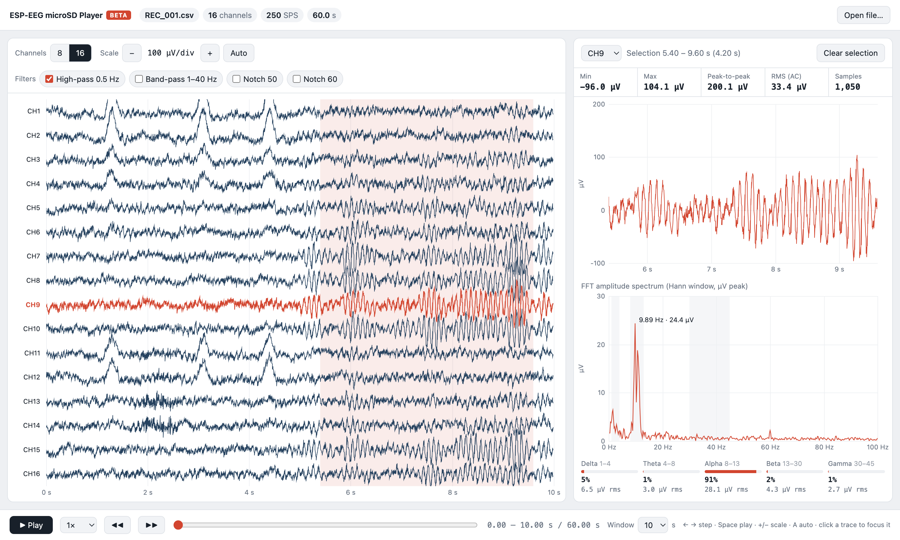

# ESP-EEG microSD Player (BETA)


<sub>Screenshot uses synthetic, EEG-like example data, not a real recording.</sub>

## Quick start

Open a terminal in the ESP-EEG folder and run the player script. Your browser opens the player.

**macOS / Linux**
```bash
cd "misc tools/uSD player"
python3 usd_player.py
```

**Windows** (Command Prompt or PowerShell)
```bat
cd "misc tools\uSD player"
python usd_player.py
```

Then drag a `REC_xxx.csv` from your microSD card onto the page. The card must be in a microSD card reader (see [step 1](#1-get-the-data-off-the-card)).
You need Python 3 and no extra packages.

> **Beta software.** This is a simple, quick-look viewer for recordings made to the microSD card on the
> ESP-EEG V2 (8-channel) and 16-Channel boards. It is provided as-is for browsing your data. It is not
> validated analysis software, so use your own pipeline (MNE, EEGLAB, BrainFlow, etc.) for anything you publish.
> Bug reports and suggestions are welcome on the [Discord](https://discord.com/invite/fVYf44JTua) or at support@cerelog.com.

The player runs in your web browser. A small Python script starts it locally, and nothing is uploaded to the internet.

## 1. Get the data off the card

The ESP-EEG board **does not** send SD recordings over USB. To read them:

1. Switch the board off and remove the microSD card.
2. Put the card in a **microSD card reader** (a USB card reader, or an SD adapter in your computer's SD slot).
3. The card appears as a drive (for example `/Volumes/MICROSD` on macOS, or `E:\` on Windows) with files named `REC_001.csv`, `REC_002.csv`, …
4. We recommend copying the files to your computer first, then ejecting the card properly before you remove it.

On macOS you may also see `._REC_001.csv` files. These are Finder metadata, so ignore them.

## 2. Run the player

You need Python 3. It is already installed on macOS and most Linux systems. On Windows, install it from [python.org](https://www.python.org/downloads/) and tick **"Add Python to PATH"** during setup.
No extra packages are needed.

| | macOS / Linux | Windows |
|---|---|---|
| Start the player | `python3 usd_player.py` | `python usd_player.py` |
| Start with a file loaded | `python3 usd_player.py /Volumes/MICROSD/REC_001.csv` | `python usd_player.py E:\REC_001.csv` |

On Windows, if `python` isn't found, try `py usd_player.py`.

Your browser opens the player. Drag a `REC_xxx.csv` onto the page, or click **Choose file…**.
To try it without a card, click **Try demo data**.

Press **Ctrl+C** in the terminal to stop the player. You can also open `viewer.html` by double-clicking it, without Python, and use **Choose file…**.

## 3. Using the player

**Left: all channels**
- **Channels 8 / 16** shows the first 8 or all 16 channels. The 16 option is greyed out for 8-channel files.
- **Scale − / + / Auto** sets the µV per division. Auto picks a scale for what's on screen.
- **Filters**: 0.5 Hz high-pass (on by default), 1–40 Hz band-pass, 50 Hz and 60 Hz notch. They are zero-phase (applied forward and back).
- **Click a trace** to send that channel to the focus panel.
- **Drag across the traces** to select a time range for the focus panel. Press Esc or click **Clear selection** to go back to the visible window.
- Channels stuck at full scale are greyed and labelled *railed / not connected*.
- Dashed red lines mark points where the firmware recorded dropped samples.

**Right: focus panel** (one channel, either the selected range or the visible window)
- The trace in true µV, with min, max, peak-to-peak, RMS and sample count
- The **FFT amplitude spectrum**: amplitude in µV against frequency in Hz. It uses a Hann window and is amplitude-corrected, so a 10 µV sine shows as a 10 µV peak. The largest peak is labelled.
- Band summary (delta, theta, alpha, beta, gamma) as a share of 1–45 Hz, with the µV rms in each band

**Bottom: time**
- **Play / Pause** at 0.5×–10× speed
- **◀◀ / ▶▶** move one window. The slider jumps anywhere in the recording.
- **Window** sets how many seconds are shown (1–60 s)

**Keyboard:** ← → step · Page Up/Down one window · Home/End · Space play · + − scale · A auto · Esc clear selection

## microSD file format

How recording works (also see the [Researcher's Guide](https://www.cerelog.com/eeg_researchers_guide.html#esp-eeg-microsd-guide)):

- Insert a **FAT32** card (32 GB or less recommended) **before** switching the board on. The card is only detected at start-up.
- Each power-on starts a new file: `REC_001.csv`, `REC_002.csv`, … up to `REC_999.csv`, in the root of the card.
- The file is flushed about once per second, so switching off can lose up to about 1 s of data, and the last line may be cut off.
  The player skips incomplete lines.

**8-channel (V2) header**

```
timestamp_ms,status,ch1,ch2,ch3,ch4,ch5,ch6,ch7,ch8
```

**16-channel header** (each of the two ADS1299 chips has its own status word)

```
timestamp_ms,status1,ch1,ch2,ch3,ch4,ch5,ch6,ch7,ch8,status2,ch9,ch10,ch11,ch12,ch13,ch14,ch15,ch16
```

Example row:

```
28,0xC00000,78494,937338,5261770,1543461,1826561,-4015724,3042013,3547113,0xC00000,8388607,...
```

| Column | Meaning |
|---|---|
| `timestamp_ms` | Milliseconds since the board started (not wall-clock time) |
| `status` / `status1` / `status2` | ADS1299 24-bit status word in hex (sync pattern, lead-off and GPIO bits) |
| `chN` | Signed raw 24-bit ADC counts (**not** volts) |

If the SD writer falls behind, the firmware writes a comment line such as `# DROPPED 12 samples`.
The player counts and marks these.

The SD card logs the native ADS1299 conversion rate (250 SPS by default). The 16-channel firmware
logs at 250 SPS even though its USB stream is averaged down to 125 Hz.

### Converting counts to microvolts

The player does this for you, assuming the default settings (VREF = 4.5 V, gain = 24):

```python
scale_factor = (2 * 4.5 / 24) / (2**24)      # V per count
microvolts   = counts * scale_factor * 1e6    # ≈ 0.02235 µV per count
```

A value of `8388607` (or `-8388608`) is full scale: that channel is railed, usually because nothing is plugged in.
If you changed the channel gain in firmware, edit `GAIN` near the top of the script in `viewer.html`.

### Loading the CSV in your own code

```python
import pandas as pd
df = pd.read_csv("REC_001.csv", comment="#", on_bad_lines="skip")
uv = df.filter(regex=r"^ch\d+$") * (2 * 4.5 / 24) / 2**24 * 1e6
t  = (df["timestamp_ms"] - df["timestamp_ms"].iloc[0]) / 1000
```

## Known limitations (beta)

- The sample rate is estimated from the timestamps (which have 1 ms resolution) and snapped to a standard ADS1299 rate
- The gain is assumed to be 24 for every channel
- The whole file is loaded into browser memory. Hour-long recordings work, but very long files may take a few seconds to open or re-filter
- There is no export or annotation yet
